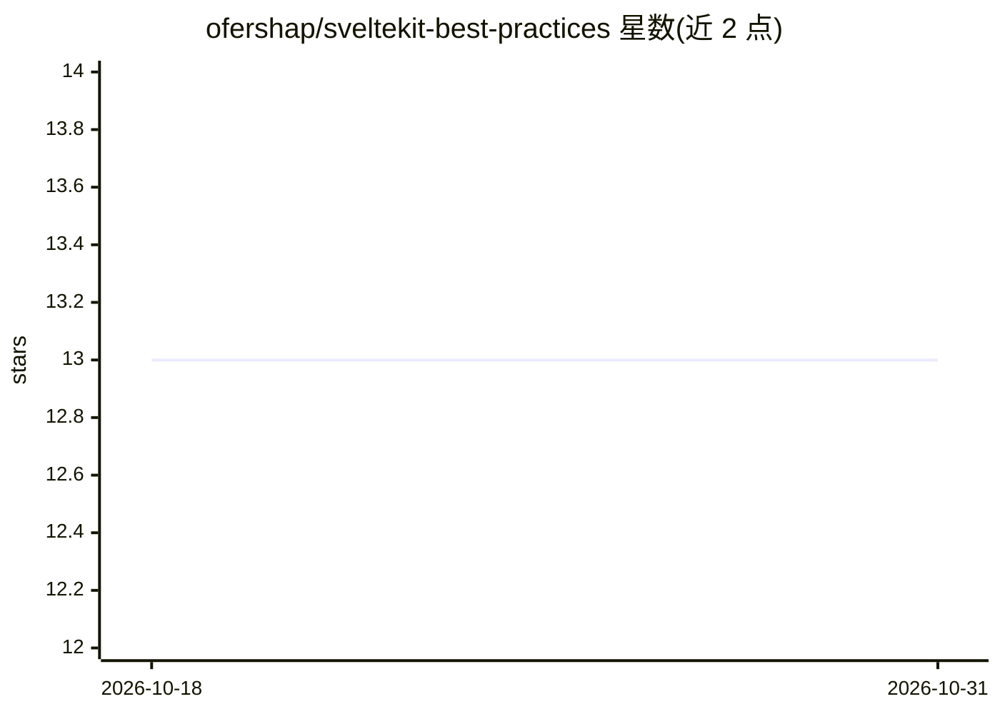

# ofershap/sveltekit-best-practices

⭐ 13 · JavaScript · MIT · 推送 2026-02-20 · [GitHub](https://github.com/ofershap/sveltekit-best-practices) · 个人维护

**教 AI 编程助手写 Svelte 5/SvelteKit 正确语法的技能规则包**

面向 Cursor、Claude Code、Windsurf 等 AI 编程助手的技能插件：包含 14 条 Svelte 5 runes、load 函数、form actions、SSR 模式的规则、一条常驻行为规则，以及 /audit 命令用于扫描代码库中的 Svelte 4 反模式（如 writable() stores、export let props、$: 响应式声明、onMount 取数）。目的是阻止 agent 生成已被 Svelte 5 废弃的语法。通过 npx skills add 或手动复制 skills/ 目录安装。

## 筛选速览

| 维度 | 判定 | 备注 |
|---|---|---|
| AI 角色 | `ai-knowledge` | 知识聚合/清单类 |
| 许可风险 | `permissive` | MIT |
| 部署形态 | `library` | 以包/库形式分发 |
| 模型依赖 | — | README 未给出锁定关系 |
| 硬件要求 | — | 无带数字的原话,不猜 |
| 安装摩擦 | `low` | 无编译、无系统依赖或容器化 |
| 成熟度 | — | 结构信号不足 |

## 能力要点

- 14 条 Svelte 5 runes / load / form actions / SSR 规则
- 常驻行为规则强制 Svelte 5 / SvelteKit 模式
- /audit 命令扫描 Svelte 4 反模式
- 附 Svelte 4→5 语法对照表

## 适用场景

- 让 Cursor/Claude Code 编写 Svelte 5 而非过时的 Svelte 4 语法
- 审计现有 SvelteKit 代码库中的旧模式
- 团队统一 AI 生成代码的 SvelteKit 风格

## 场景标签

`提示工程` · 领域:Agent 开发

## 证据(README 行号)

> L10: > AI coding assistants generate Svelte 4 code - `writable()` stores, `export let` props, `$:`
> L28: |Skill|`sveltekit-best-practices`|14 rules for Svelte 5 runes, load functions, form actions, SSR, and more|

## 星数曲线

2026-10-18 13 → 2026-10-31 13（+0）

---
*卡片 v1 · prompt 1.4 · 生成 2026-10-31 · 置信度 high · 依据 README sha `67b5e269381a` · [字段定义](../../DATASET.md)*
