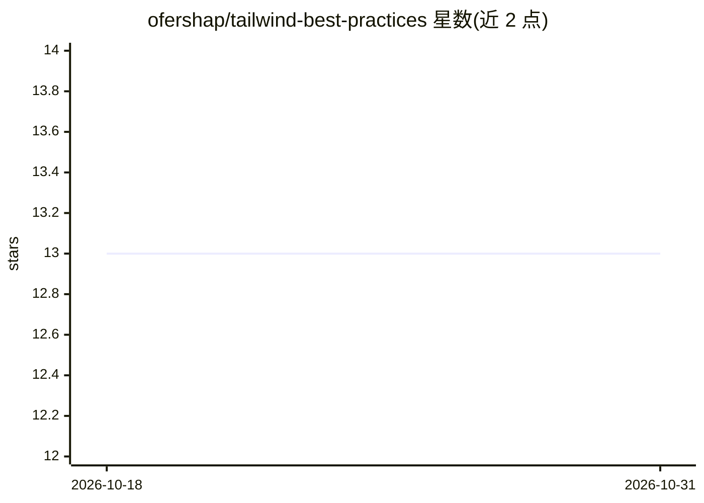

# ofershap/tailwind-best-practices

⭐ 13 · JavaScript · MIT · 推送 2026-02-20 · [GitHub](https://github.com/ofershap/tailwind-best-practices) · 个人维护

**约束 AI 编码代理输出 Tailwind v4 语法的规则技能包**

面向 Cursor、Claude Code、Windsurf 等 AI 编码助手的知识/规则插件：提供 12 条 Tailwind CSS v4 语法规则（@theme、@import、opacity、渐变、容器查询、@utility 等），并附 v3 反模式对照表与 /audit 命令扫描代码库中的过时写法。针对编码助手基于 v3 数据训练、常生成 tailwind.config.js、bg-opacity-50 等已废弃模式的问题。通过 npx skills add 安装或将 skills/ 目录复制到 .cursor/skills/ 或 .claude/skills/。

## 筛选速览

| 维度 | 判定 | 备注 |
|---|---|---|
| AI 角色 | `ai-ecosystem` | LLM/agent 周边工具 |
| 许可风险 | `permissive` | MIT |
| 部署形态 | `library` | 以包/库形式分发 |
| 模型依赖 | — | README 未给出锁定关系 |
| 硬件要求 | — | 无带数字的原话,不猜 |
| 安装摩擦 | `low` | 无编译、无系统依赖或容器化 |
| 成熟度 | — | 结构信号不足 |

## 能力要点

- 12 条 Tailwind v4 语法规则与常驻 best-practices 行为规则
- v3 反模式与 v4 正确写法对照表
- /audit 命令扫描代码库中的 Tailwind v3 过时模式

## 适用场景

- 让 Cursor/Claude Code 等 AI 编码助手生成符合 Tailwind v4 的代码
- 迁移或审查现有代码库中的 Tailwind v3 遗留写法

## 场景标签

`提示工程` · 领域:Agent 开发

## 证据(README 行号)

> L6: Stop your AI agent from generating Tailwind CSS v3 code. 12 rules for Tailwind v4 syntax, CSS-first
> L9: > AI coding assistants (Cursor, Claude Code, Copilot, Codex) are trained on Tailwind v3 data. They
> L15: ### Cursor / Claude Code / Windsurf

## 星数曲线

2026-10-18 13 → 2026-10-31 13（+0）

---
*卡片 v1 · prompt 1.4 · 生成 2026-10-31 · 置信度 high · 依据 README sha `e0d06288943d` · [字段定义](../../DATASET.md)*
