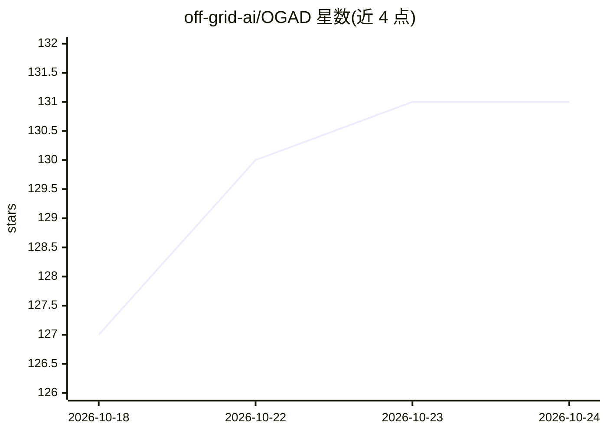

# off-grid-ai/OGAD

⭐ 131 · TypeScript · AGPL-3.0 · 推送 2026-10-23 · [GitHub](https://github.com/off-grid-ai/OGAD) · [官网](https://getoffgridai.co/pro/) · 组织维护

**桌面端本地私有 AI 助手：聊天/图像/语音 + OpenAI 兼容网关**

macOS/Windows/Linux 桌面应用，本地运行开源模型（文本、视觉、图像生成、语音），推理通过内置的 llama.cpp、stable-diffusion.cpp、whisper.cpp 与 Kokoro 完成，数据不经服务器。应用分三层：聊天/图像/语音/Artifacts/RAG 项目的工作室；本机 127.0.0.1:7878 的 OpenAI 兼容 API 网关（可 headless 运行、通过 HTTP 管理模型）；付费 Pro 层提供屏幕记忆、会议转录、听写等常驻功能。Electron + React 技术栈，AGPL 开源核心 + 私有 Pro 包的 open-core 架构。

## 筛选速览

| 维度 | 判定 | 备注 |
|---|---|---|
| AI 角色 | `ai-native` | 本体是模型或模型工具 |
| 许可风险 | `viral` | AGPL-3.0 |
| 部署形态 | `desktop` | 安装包/桌面程序 |
| 模型依赖 | local-ok | 支持本地模型 |
| 硬件要求 | — | 无带数字的原话,不猜 |
| 安装摩擦 | `medium` | 含编译或系统依赖之一 |
| 成熟度 | — | 结构信号不足 |

## 能力要点

- 内置 llama.cpp/whisper.cpp/stable-diffusion.cpp/Kokoro，全部推理在本地硬件运行
- 本地 OpenAI 兼容网关（127.0.0.1:7878），支持无 UI headless 模式与 HTTP 模型管理
- 支持 MCP 连接器在聊天内调用外部工具
- Pro 层：屏幕 OCR 记忆、会议转录、全局听写、剪贴板管理（opt-in、本地）

## 适用场景

- 在不联网不用账号的前提下本地跑文本/图像/语音模型
- 把本地模型暴露成 OpenAI 兼容 API 供自己的应用调用
- 在家中服务器或 homelab 上以 headless 网关形式服务本地模型

## 场景标签

`AI 助手` `模型网关` `图像生成` `RAG` · 领域:Agent 开发

## 证据(README 行号)

> L34: Off Grid AI is a **local-first AI runtime** for your desktop. Download open models from the
> L36: inference runs on your hardware via bundled `llama.cpp`, `stable-diffusion.cpp`,
> L42: 1. **A studio** — chat (text + vision + reasoning), on-device image generation, voice
> L45: 2. **A gateway** — one local OpenAI-compatible API (`http://127.0.0.1:7878/v1`, no key)

## 星数曲线

2026-10-18 127 → 2026-10-24 131（+4）

---
*卡片 v1 · prompt 1.4 · 生成 2026-10-22 · 置信度 mid · 依据 README sha `9866039abcb2` · [字段定义](../../DATASET.md)*
