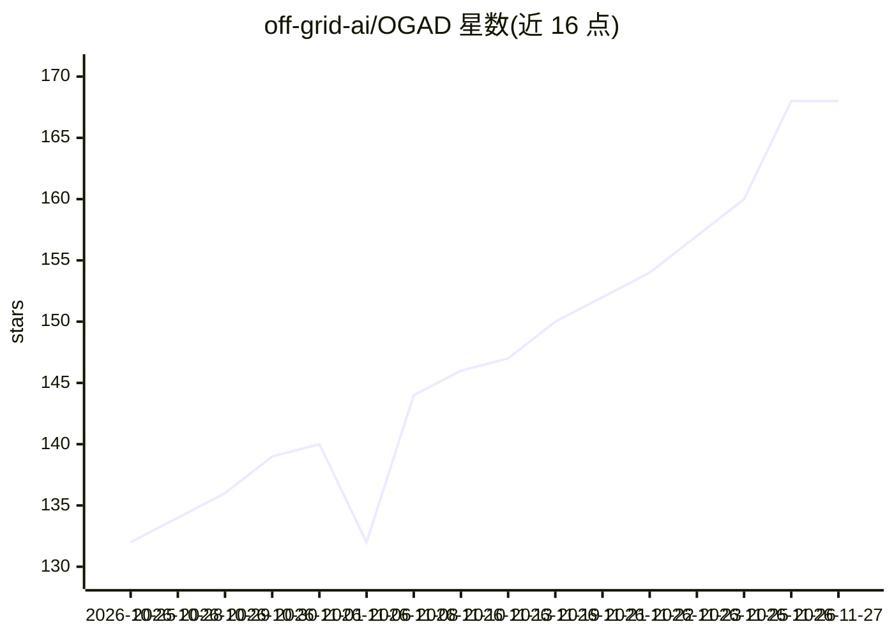

# off-grid-ai/OGAD

⭐ 168 · TypeScript · AGPL-3.0 · 推送 2026-11-26 · [GitHub](https://github.com/off-grid-ai/OGAD) · [官网](getoffgridai.co/pro) · 个人维护

**本地优先的桌面 AI 助手与推理网关，全程离线运行**

一个 local-first 桌面 AI 应用，内置目录下载开源模型（支持 GGUF），通过捆绑的 llama.cpp、stable-diffusion.cpp、whisper.cpp 和 Kokoro 在本机完成文本/视觉/图像/语音推理。包含三部分：聊天与图像生成、语音、RAG 项目、MCP 连接器的 studio；一个无密钥的本地 OpenAI 兼容 API 网关（可 headless 运行）；以及付费 Pro 版（屏幕 OCR 记忆、本地会议转录、听写、剪贴板管理、审批式动作），采用 open core + 私有包架构。提供 macOS/Windows/Linux 安装包与源码构建。

## 筛选速览

| 维度 | 判定 | 备注 |
|---|---|---|
| AI 角色 | `ai-ecosystem` | LLM/agent 周边工具 |
| 许可风险 | `viral` | AGPL-3.0 |
| 部署形态 | `desktop` | 安装包/桌面程序 |
| 模型依赖 | local-ok | 支持本地模型 |
| 硬件要求 | — | 无带数字的原话,不猜 |
| 安装摩擦 | `medium` | 含编译或系统依赖之一 |
| 成熟度 | — | 结构信号不足 |

## 能力要点

- 捆绑 llama.cpp/whisper.cpp/stable-diffusion.cpp/Kokoro，全模态本地推理
- 本地 OpenAI 兼容网关（127.0.0.1:7878），支持无 UI headless 运行与 HTTP 模型管理
- Projects 支持文档上传与带引用来源的 RAG，聊天内调用 MCP 连接器
- Pro 层提供屏幕 OCR 记忆、本地会议转录与审批队列

## 适用场景

- 在无网络/隐私敏感环境下使用本地模型聊天与生成图像
- 为自建应用接入本地模型的 OpenAI 兼容 API
- 用本地模型对个人文档做检索问答
- 本地转录会议与语音听写

## 场景标签

`AI 助手` `模型网关` `文档问答` `图像生成` · 领域:Agent 开发

## 证据(README 行号)

> L36: Off Grid AI is a **local-first AI runtime** for your desktop. Download open models from the
> L48: 2. **A gateway** — one local OpenAI-compatible API (`http://127.0.0.1:7878/v1`, no key)
> L50: 3. **Off Grid AI Pro** — an always-on private layer that _sees_ your work (screen → OCR),

## 星数曲线

2026-10-25 132 → 2026-11-27 168（+36）

---
*卡片 v1 · prompt 1.4 · 生成 2026-11-26 · 置信度 high · 依据 README sha `0171ae234f6d` · [字段定义](../../DATASET.md)*
