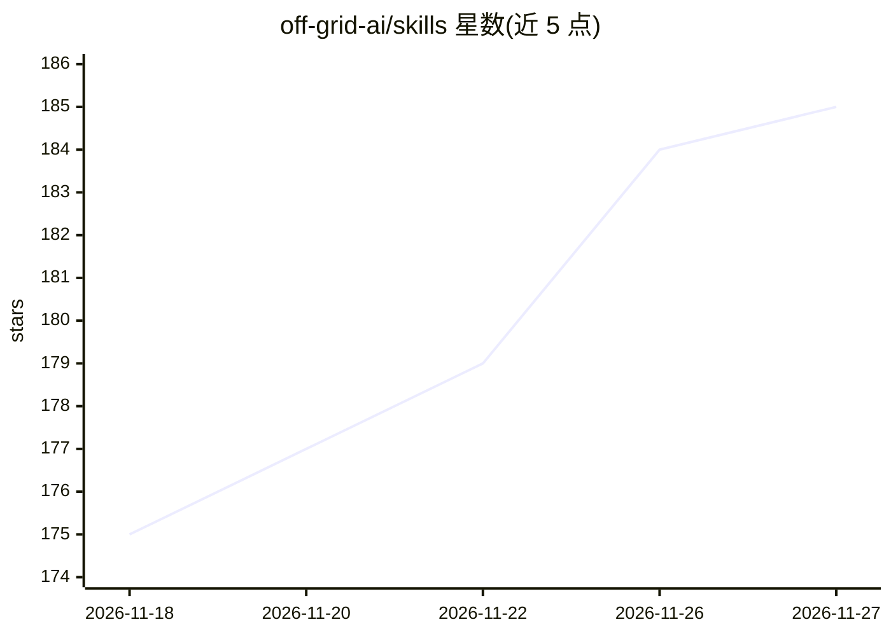

# off-grid-ai/skills

⭐ 185 · Python · MIT · 推送 2026-11-25 · [GitHub](https://github.com/off-grid-ai/skills) · [官网](https://getoffgridai.co/download) · 个人维护

**为 Claude Code 等 agent 提供 49 个编码技能包**

一组 MIT 许可的 agent 技能集合，每个技能是一个含 SKILL.md 的 Markdown 指令包，agent 在处理匹配请求时读取并遵循。技能按三组组织：代码评审、回归防护（以真实用户方式点击测试、bug 回归测试）、遗留代码改造（代码库问答、变更影响分析、模块审计等）。支持 Claude Code、Codex、Cursor 及 60+ 其他 agent 安装，提供 npx、插件市场与 shell 脚本三种安装途径。作者自述这些技能用于构建其个人产品 Off Grid AI。

## 筛选速览

| 维度 | 判定 | 备注 |
|---|---|---|
| AI 角色 | `ai-ecosystem` | LLM/agent 周边工具 |
| 许可风险 | `permissive` | MIT |
| 部署形态 | `library` | 以包/库形式分发 |
| 模型依赖 | — | README 未给出锁定关系 |
| 硬件要求 | — | 无带数字的原话,不猜 |
| 安装摩擦 | `low` | 无编译、无系统依赖或容器化 |
| 成熟度 | — | 结构信号不足 |

## 能力要点

- 每个技能为 SKILL.md 纯 Markdown 文件，请求匹配时才被 agent 读取
- 覆盖评审、测试、遗留代码改造三组共 15 个技能
- 支持 npx、Claude/Codex 插件市场、无 Node 依赖的 shell 脚本安装
- MIT 许可，第三方文件保留自身许可

## 适用场景

- 让编码 agent 在改动前分析影响范围并自动测试
- 让 agent 处理 PR 评审意见直到可合并
- 为没有测试的旧代码生成并通过测试

## 场景标签

`代码审查` `编码 Agent` · 领域:编码与开发

## 证据(README 行号)

> L11: Each skill is a short playbook your agent reads before it starts, so it tests every change in your real app and che
> L30: npx skills add off-grid-ai/skills
> L121: - Each skill is a folder with a `SKILL.md`, plain Markdown your agent reads when your request matches it. Nothing 

## 星数曲线

2026-11-18 175 → 2026-11-27 185（+10）

---
*卡片 v1 · prompt 1.4 · 生成 2026-11-26 · 置信度 high · 依据 README sha `19734d25714d` · [字段定义](../../DATASET.md)*
