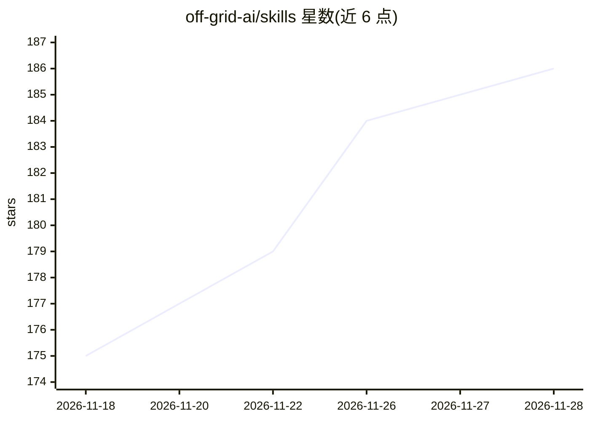

# off-grid-ai/skills

⭐ 186 · Python · MIT · 推送 2026-11-27 · [GitHub](https://github.com/off-grid-ai/skills) · [官网](https://www.wednesday.is/mcp/) · 个人维护

**为 AI 编程 agent 提供 49 个工程流程技能的集合**

一组 MIT 许可的 agent 技能包，每个技能是一个 SKILL.md 格式的 playbook，agent 在执行请求前读取并遵循其中流程。内容覆盖代码评审、用户路径真实测试、变更影响分析（blast-radius）、遗留代码补测试、模块审计与部署检查等三类共 15 个技能。支持 Claude Code、Codex、Cursor 等 60+ agent，可通过 npx、Claude/Codex 插件市场或 shell 脚本安装，各技能分三个插件集、可按需裁剪。

## 筛选速览

| 维度 | 判定 | 备注 |
|---|---|---|
| AI 角色 | `ai-knowledge` | 知识聚合/清单类 |
| 许可风险 | `permissive` | MIT |
| 部署形态 | `library` | 以包/库形式分发 |
| 模型依赖 | — | README 未给出锁定关系 |
| 硬件要求 | — | 无带数字的原话,不猜 |
| 安装摩擦 | `low` | 无编译、无系统依赖或容器化 |
| 成熟度 | — | 结构信号不足 |

## 能力要点

- 每个技能为 SKILL.md 纯 Markdown playbook，请求匹配时由 agent 读取，无需额外运行
- 提供 test-like-a-user（打开真实界面操作验证，不用 mock）、blast-radius（变更前计算影响范围）、safe-to-merge（自动回应评审意见直至可合并）等技能
- 支持 npx 一行安装、Claude Code/Codex 插件市场安装及无 Node 依赖的 shell 脚本安装
- 三个插件集分装技能，可单独卸载，技能间按名称互相调用

## 适用场景

- 让 AI 编程助手在改动代码前自动跑真实界面测试
- 改老代码前先让 agent 分析依赖和破坏范围
- 让 PR 在合并前自动回应并修复所有评审意见
- 给没有测试的遗留代码补上能跑通的测试

## 场景标签

`代码审查` `编码 Agent` · 领域:编码与开发

## 证据(README 行号)

> L11: Each skill is a short playbook your agent reads before it starts, so it tests every change in your real app and che
> L123: - Each skill is a folder with a `SKILL.md`, plain Markdown your agent reads when your request matches it. Nothing 

## 星数曲线

2026-11-18 175 → 2026-11-28 186（+11）

---
*卡片 v1 · prompt 1.4 · 生成 2026-11-28 · 置信度 high · 依据 README sha `d597f03bede7` · [字段定义](../../DATASET.md)*
