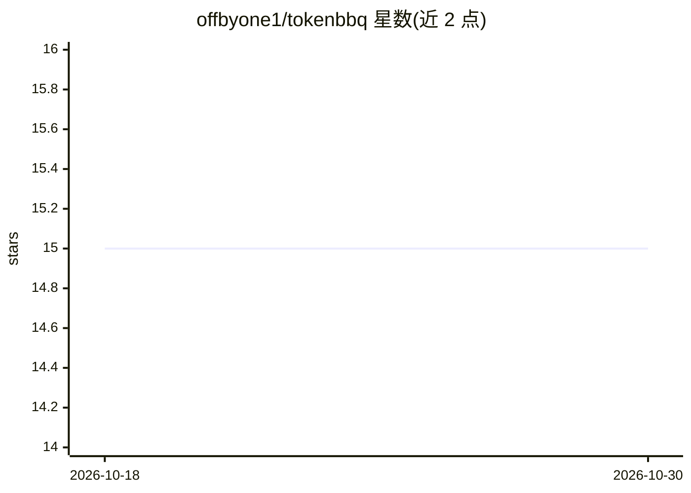

# offbyone1/tokenbbq

⭐ 15 · TypeScript · MIT · 推送 2026-10-09 · [GitHub](https://github.com/offbyone1/tokenbbq) · [官网](https://offbyone.cloud) · 个人维护

**本地仪表盘：读取 AI 编码工具的用量数据，展示 token 与估算成本**

面向使用 AI 编码工具的开发者的本地可视化仪表盘。直接通过 npx 运行，无需安装、配置或 API key；读取 Claude Code、Codex、Gemini、OpenCode、Amp、Pi-Agent 六种工具在本地已写入的用量数据，归一化后按日/月/来源/模型/项目分组，生成绝对 token 数、估算成本、活跃天数、成本趋势热力图等看板，并在 Codex 暴露时读取本地限流快照。本地运行 localhost 服务器，不代理模型流量、不上传数据，模型定价从 LiteLLM 获取。产品界面仅限浏览器仪表盘。数据加载模式基于 ccusage 扩展。

## 筛选速览

| 维度 | 判定 | 备注 |
|---|---|---|
| AI 角色 | `ai-ecosystem` | LLM/agent 周边工具 |
| 许可风险 | `permissive` | MIT |
| 部署形态 | `library` | 以包/库形式分发 |
| 模型依赖 | — | README 未给出锁定关系 |
| 硬件要求 | — | 无带数字的原话,不猜 |
| 安装摩擦 | `low` | 无编译、无系统依赖或容器化 |
| 成熟度 | — | 结构信号不足 |

## 能力要点

- npx 免安装运行，无 API key、无云端后端
- 支持 Claude Code/Codex/Gemini/OpenCode/Amp/Pi-Agent 六种工具的本地用量文件
- 按日/月/来源/模型/项目分组展示 token 与估算成本
- 读取 Codex 本地限流快照

## 适用场景

- 想知道 AI 编码工具到底用了多少 token、花了多少钱
- 按项目和模型维度拆分查看编码助手成本
- 查看 Claude/Codex 的本地限流状态

## 场景标签

 · 领域:AI 编码工具/用量分析

## 证据(README 行号)

> L11: TokenBBQ is a local dashboard for AI coding tool usage. It reads the local data your tools already write and turns 
> L83: 1. It reads the local usage data your AI coding tools already write.

## 星数曲线

2026-10-18 15 → 2026-10-30 15（+0）

---
*卡片 v1 · prompt 1.4 · 生成 2026-10-30 · 置信度 high · 依据 README sha `19e47eaddb9f` · [字段定义](../../DATASET.md)*
