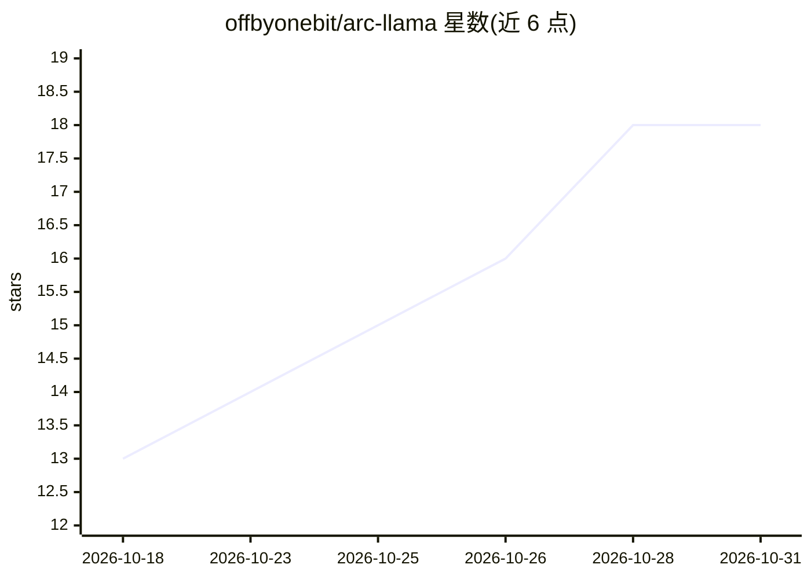

# offbyonebit/arc-llama

⭐ 18 · Python · MIT · 推送 2026-10-28 · [GitHub](https://github.com/offbyonebit/arc-llama) · 个人维护

**Intel Arc GPU 上一键运行的 llama.cpp 运行时与服务**

面向 Intel Arc 显卡用户的命令行工具：自动检测 Alchemist/Battlemage/Lunar Lake iGPU，按代际应用 SYCL/oneAPI 环境与安全默认值，扫描并注册 GGUF 模型，以每模型一进程加内部路由的方式运行 llama-server，对外暴露 OpenAI 兼容与 Ollama 兼容 API（端口 11437）。附 Web UI 与 Textual 终端 UI，支持 Hugging Face 模型发现下载、后台自动调优、运行时升级金丝雀检查与回滚。Work agent 功能为实验性，需环境变量开启。通过 pip 安装。

## 筛选速览

| 维度 | 判定 | 备注 |
|---|---|---|
| AI 角色 | `ai-ecosystem` | LLM/agent 周边工具 |
| 许可风险 | `permissive` | MIT |
| 部署形态 | `self-host` | docker 或自建部署 |
| 模型依赖 | local-ok | 支持本地模型 |
| 硬件要求 | — | 无带数字的原话,不猜 |
| 安装摩擦 | `low` | 无编译、无系统依赖或容器化 |
| 成熟度 | `idea` | |

## 能力要点

- 自动检测 Intel Arc GPU 并按代际配置 SYCL/oneAPI 环境
- 同时暴露 OpenAI 兼容与 Ollama 兼容 API（/v1 与 /api）
- GGUF 自动扫描注册、VRAM 匹配估算与后台自动调优
- 自带 Web UI 与 Textual 终端 UI，含实验性 Work agent

## 适用场景

- 新装 Intel Arc 显卡后快速搭建本地 LLM 推理服务
- 在 Open WebUI 等 OpenAI 兼容客户端中使用本地 GGUF 模型
- 让 Ollama 兼容客户端直接接入本地推理服务

## 场景标签

`推理引擎` · 领域:训练与推理

## 证据(README 行号)

> L5: `arc-llama` is a single command-line tool that detects your Intel Arc card,
> L7: registers GGUF models, and runs an OpenAI-compatible server in front of them.
> L127: - **OpenAI-compatible API** at `http://127.0.0.1:11437/v1/...`. Plug it into

## 星数曲线

2026-10-18 13 → 2026-10-31 18（+5）

---
*卡片 v1 · prompt 1.4 · 生成 2026-10-29 · 置信度 mid · 依据 README sha `7320ef330071` · [字段定义](../../DATASET.md)*
