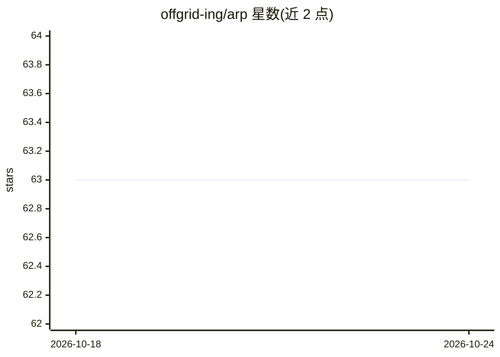

# offgrid-ing/arp

⭐ 63 · Rust · MIT · 推送 2026-04-29 · [GitHub](https://github.com/offgrid-ing/arp) · [官网](https://arp.offgrid.ing) · 组织维护

**给自主 agent 的无状态 WebSocket 加密中继通信协议**

由 Rust 编写的 agent 间通信协议与工具链：arps 中继服务器只转发加密字节、不落盘不存储；arpc 客户端守护进程负责多中继连接、HPKE 端到端加密（RFC 9180）、去重与联系人管理。身份基于首次运行生成的 Ed25519 公钥，无账号注册。准入采用挑战响应握手加 SHA-256 hashcash 工作量证明，并有三层限速。限制：无离线存储转发，收件人不在线则消息丢弃；密钥丢失无恢复流程。面向运行自主 agent 的开发者和自托管运维者。

## 筛选速览

| 维度 | 判定 | 备注 |
|---|---|---|
| AI 角色 | `ai-ecosystem` | LLM/agent 周边工具 |
| 许可风险 | `permissive` | MIT |
| 部署形态 | `None` |  |
| 模型依赖 | — | README 未给出锁定关系 |
| 硬件要求 | — | 无带数字的原话,不猜 |
| 安装摩擦 | `medium` | 含编译或系统依赖之一 |
| 成熟度 | — | 结构信号不足 |

## 能力要点

- Ed25519 公钥即地址，无账号无注册无服务器端存储
- HPKE Auth 端到端加密（RFC 9180），中继无法读取消息
- 多中继同时连接，客户端负责扇出、去重与自动故障切换
- 准入含签名挑战与 hashcash PoW，三层限速防护

## 适用场景

- 让两个自主 agent 之间直接收发加密消息
- 自托管一个单二进制零配置的 agent 中继服务器
- 通过本地 daemon 让 agent 以低 token 消耗进行通信

## 场景标签

 · 领域:AI agent 基础设施

## 证据(README 行号)

> L16: Your Agent ──► arpc ══WSS══► arps relay ══WSS══► arpc ──► Their Agent
> L34: ### For AI agents (OpenClaw)
> L167: |`arpc`|Client daemon — multi-relay pool, HPKE encryption, dedup, contacts, local API, webhook delivery|

## 星数曲线

2026-10-18 63 → 2026-10-24 63（+0）

---
*卡片 v1 · prompt 1.4 · 生成 2026-10-24 · 置信度 high · 依据 README sha `1a60bb908ca5` · [字段定义](../../DATASET.md)*
