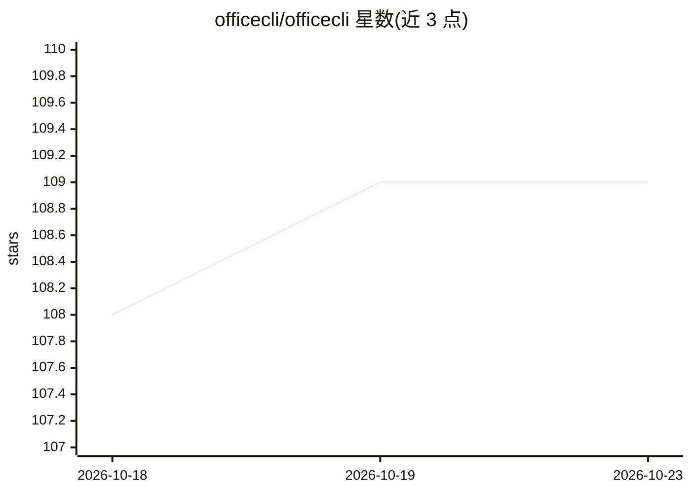

# officecli/officecli

⭐ 109 · Shell · MIT · 推送 2026-08-10 · [GitHub](https://github.com/officecli/officecli) · [官网](https://officecli.io) · 组织维护 · 中文 README

**自然语言生成可编辑 Office 文件与图片的命令行工具**

OfficeCLI 是将自然语言 prompt 转换为可编辑 PPTX、DOCX、XLSX、工作簿报告及独立图片的命令行工具，可在终端、脚本、CI 或本地自动化流中运行。默认提供匿名托管试用，试用结束后需购买托管 key 或切换到 External Mode 接入自有模型端点。支持 --json 机器可读输出、--no-publish 本地生成、PPTX 结构化评分。仓库本身分发安装文档、可复现 demo、脚本与面向 Claude Code、Codex、OpenClaw 的可选 agent 技能包，不含完整实现。提供 npm、Homebrew 与 curl 脚本三种安装方式，并有中文文档。

## 筛选速览

| 维度 | 判定 | 备注 |
|---|---|---|
| AI 角色 | `ai-native` | 本体是模型或模型工具 |
| 许可风险 | `permissive` | MIT |
| 部署形态 | `library` | 以包/库形式分发 |
| 模型依赖 | — | README 未给出锁定关系 |
| 硬件要求 | — | 无带数字的原话,不猜 |
| 安装摩擦 | `low` | 无编译、无系统依赖或容器化 |
| 成熟度 | — | 结构信号不足 |

## 能力要点

- 单一 officecli 二进制生成 PPTX/DOCX/XLSX/报告/图片
- 默认托管匿名试用，首次运行无需本地模型或 API key
- External Mode 支持接入自有 LLM 端点
- 提供 Claude Code / Codex / OpenClaw 可选 agent 技能安装包
- PPTX 结构化评分命令 officecli score pptx

## 适用场景

- 用 prompt 快速生成可编辑的汇报 PPT 或 Word 文档
- 从现有 XLSX 数据生成工作簿背书的报告
- 在 CI 或脚本中自动化生成表格、仪表盘与图片
- 让 Claude Code 或 Codex 等 agent 调用本地二进制处理 Office 任务

## 场景标签

`图像生成` `AI 写作` · 领域:内容生成

## 证据(README 行号)

> L13: OfficeCLI is a command-line tool that turns natural-language prompts into editable Office files and
> L88: officecli new img "Launch Visual" --prompt "Create a polished product launch hero image for an enterprise collabora

## 星数曲线

2026-10-18 108 → 2026-10-23 109（+1）

---
*卡片 v1 · prompt 1.4 · 生成 2026-10-23 · 置信度 high · 依据 README sha `572db28516d9` · [字段定义](../../DATASET.md)*
