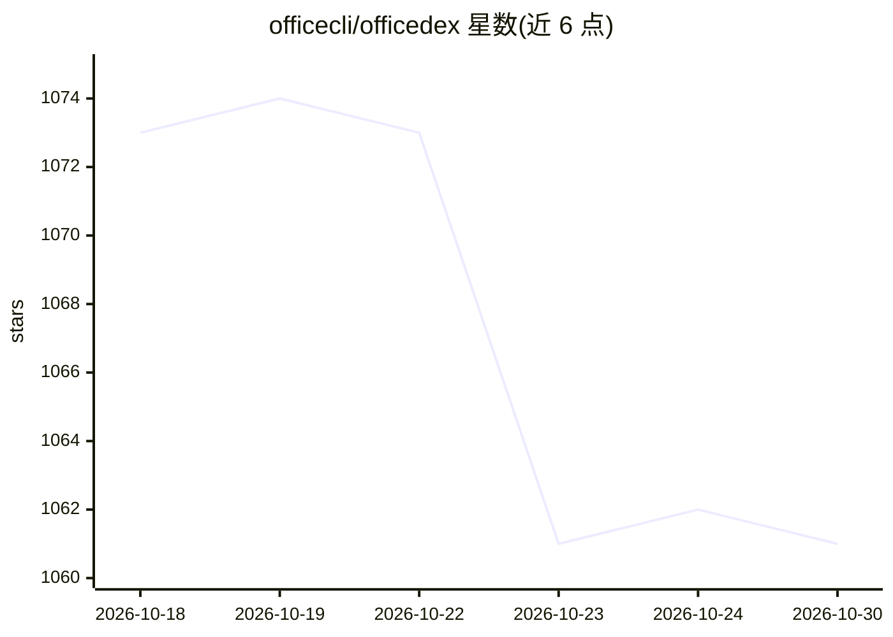

# officecli/officedex

⭐ 1,061 · JavaScript · GPL-3.0 · 推送 2026-10-26 · [GitHub](https://github.com/officecli/officedex) · [官网](https://officecli.io) · 组织维护

**自然语言生成 Word/PPT/Excel 的 AI 原生桌面办公平台**

基于 Wails（Go + React）的桌面应用，通过自然语言提示直接生成原生 .docx/.pptx/.xlsx/.pdf 文件，不经 HTML 中间格式。文档生成由独立的 officecli 子进程经 JSON-RPC 完成，支持配置 OpenAI/Anthropic/Azure 或自托管 vLLM/Ollama 等自有 LLM，数据默认本地存储，也可选官方托管运行时。功能含任务流实时查看、DOCX/PPTX/XLSX/PDF 内联预览、图片输入理解、跨会话风格记忆与多 agent 协作。macOS/Windows 提供安装包，Linux 需源码运行。

## 筛选速览

| 维度 | 判定 | 备注 |
|---|---|---|
| AI 角色 | `ai-native` | 本体是模型或模型工具 |
| 许可风险 | `viral` | GPL-3.0 |
| 部署形态 | `desktop` | 安装包/桌面程序 |
| 模型依赖 | local-ok | 支持本地模型 |
| 硬件要求 | — | 无带数字的原话,不猜 |
| 安装摩擦 | `low` | 无编译、无系统依赖或容器化 |
| 成熟度 | — | 结构信号不足 |

## 能力要点

- 自然语言直接产出原生 OOXML 文件（.docx/.pptx/.xlsx/.pdf）
- 自有 LLM 配置（OpenAI 兼容协议/Anthropic/Azure/vLLM/Ollama），数据默认本地
- 多 agent 协作（规划结构/写内容/处理格式）与流式任务状态、任务中交互
- DOCX/PPTX/XLSX/PDF 内联预览，无需安装 Office

## 适用场景

- 用一句话生成季度报告、路演 PPT 或财务分析表格
- 接入自己的 API key 或本地模型，本地生成办公文档
- 上传参考文档或截图，让 AI 按视觉上下文产出成品文件

## 场景标签

`AI 写作` · 领域:内容生成

## 证据(README 行号)

> L22: > Say what you need → OfficeDex produces native `.docx` / `.pptx` / `.xlsx` directly.
> L83: In one sentence: **Tell it what you want — it generates Word / PPT / Excel for you.**
> L85: - 📝 **Natural language to documents** — Type "write a Q3 sales analysis report" and get structure, sections, illust

## 星数曲线

2026-10-18 1,073 → 2026-10-30 1,061（-12）

---
*卡片 v1 · prompt 1.4 · 生成 2026-10-21 · 置信度 high · 依据 README sha `007148832ad1` · [字段定义](../../DATASET.md)*
