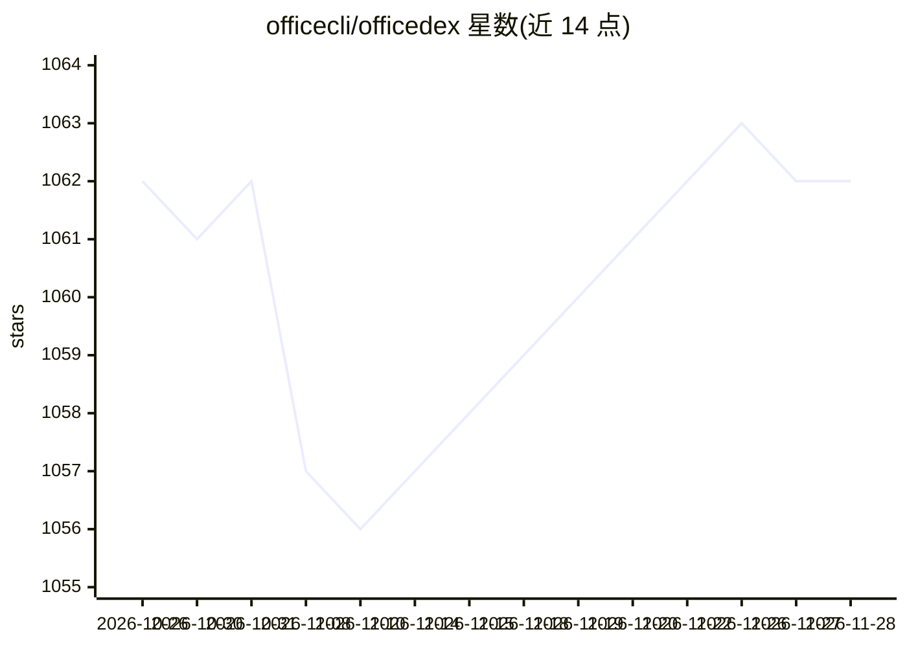

# officecli/officedex

⭐ 1,062 · JavaScript · GPL-3.0 · 推送 2026-11-27 · [GitHub](https://github.com/officecli/officedex) · [官网](https://officecli.io) · 组织维护 · 中文 README

**面向办公用户的桌面应用：一句话生成 Word/PPT/Excel 文档**

OfficeDex 是 OfficeCLI 命令行工具的桌面 GUI 外壳，基于 Wails（Go 后端 + React 前端）构建。用户输入自然语言后，由解耦的 officecli 子进程（JSON-RPC 通信）生成原生 .docx/.pptx/.xlsx 文件，支持行内预览（无需安装 Office）、图片输入、多 agent 协作（规划/写作/排版分工）与跨会话样式记忆。LLM 需用户自行配置（OpenAI/Anthropic/Azure 兼容协议或本地模型），默认本地运行，生成需联网或本地模型。提供 macOS/Windows 安装包，Linux 需从源码运行。

## 筛选速览

| 维度 | 判定 | 备注 |
|---|---|---|
| AI 角色 | `ai-native` | 本体是模型或模型工具 |
| 许可风险 | `viral` | GPL-3.0 |
| 部署形态 | `desktop` | 安装包/桌面程序 |
| 模型依赖 | local-ok | 支持本地模型 |
| 硬件要求 | — | 无带数字的原话,不猜 |
| 安装摩擦 | `low` | 无编译、无系统依赖或容器化 |
| 成熟度 | — | 结构信号不足 |

## 能力要点

- 自然语言直接生成原生 OOXML 文件（.docx/.pptx/.xlsx），无中间 HTML
- DOCX/PPTX/XLSX/PDF 行内预览，无需安装 Office
- 多 agent 协作（结构规划/内容写作/格式处理）与跨会话样式记忆
- 可配置任意 LLM：OpenAI 兼容协议、Anthropic、Azure、自托管或本地模型

## 适用场景

- 用一句话生成季度销售分析报告、PPT 与数据表格
- 本地模型环境下离线生成办公文档
- 上传 .docx/.pdf/.md 素材或截图作为参考生成文档
- 不打开 Office 即可预览生成的文档

## 场景标签

`多智能体` `AI 写作` · 领域:Agent 开发

## 证据(README 行号)

> L85: In one sentence: **Tell it what you want — it generates Word / PPT / Excel for you.**
> L91: - ⚙️ **Run locally or hosted** — Bring your own LLM (OpenAI / Claude / self-hosted) or use the OfficeCLI hosted run
> L251: OfficeCLI is the underlying command-line tool (a separate Go repo) that handles actual document generation, LLM ca

## 星数曲线

2026-10-26 1,062 → 2026-11-28 1,062（+0）

---
*卡片 v1 · prompt 1.4 · 生成 2026-11-28 · 置信度 high · 依据 README sha `9266c84c725c` · [字段定义](../../DATASET.md)*
