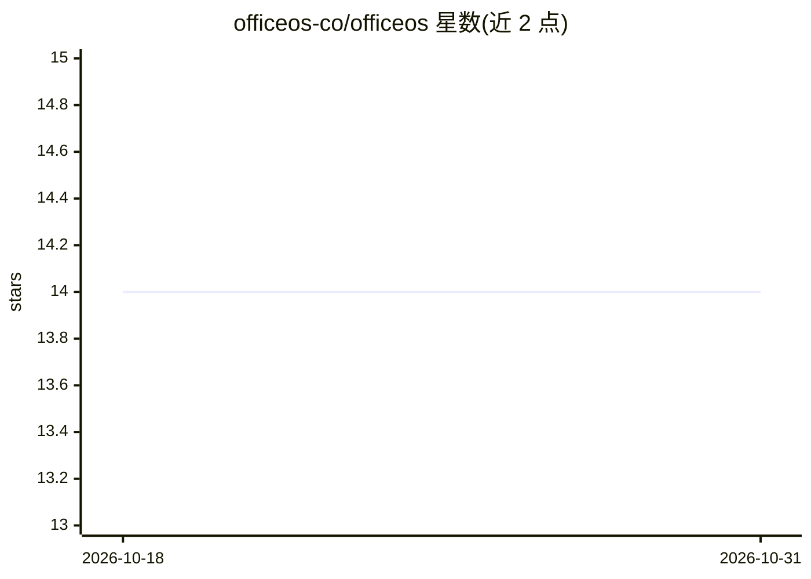

# officeos-co/officeos

⭐ 14 · C# · Apache-2.0 · 推送 2026-05-17 · [GitHub](https://github.com/officeos-co/officeos) · [官网](https://www.officeos.co/) · 组织维护

**自托管的编码 agent 声明式控制平面与运行基础设施**

面向团队的开源自托管 agent 控制平面：以 officeos.io/v1 清单在代码仓库中声明 agent、provider、工具、凭据与运行策略，apply 到控制平面后运行，每次运行获得隔离沙盒工作区、浏览器能力、MCP 工具接入、持久记忆与结构化类型化日志。首要场景是编码工作：克隆仓库、改文件、执行声明的验证命令并交回补丁或 PR。产品主面为 officeos CLI 与清单文件，另有运维用 dashboard。支持 Docker Compose 或 Kubernetes 自托管，模型无关（自带 Anthropic/OpenAI/Google/xAI 等密钥）。

## 筛选速览

| 维度 | 判定 | 备注 |
|---|---|---|
| AI 角色 | `ai-ecosystem` | LLM/agent 周边工具 |
| 许可风险 | `permissive` | Apache-2.0 |
| 部署形态 | `self-host` | docker 或自建部署 |
| 模型依赖 | — | README 未给出锁定关系 |
| 硬件要求 | — | 无带数字的原话,不猜 |
| 安装摩擦 | `low` | 无编译、无系统依赖或容器化 |
| 成熟度 | — | 结构信号不足 |

## 能力要点

- 清单优先：agent/provider/凭据/策略均以 officeos.io/v1 资源版本化声明
- 每次运行获得带文件系统与 shell 访问的沙盒工作区
- 内置工具与 MCP server 接入、持久记忆、附随浏览器
- 结构化日志：message/tool call/tool result 时间线可审计

## 适用场景

- 在自己云上运行与运维编码 agent 集群
- 以版本化清单管理 agent 行为、凭据与运行策略
- 审计 agent 运行的完整类型化日志轨迹

## 场景标签

`编码 Agent` `Agent 框架` · 领域:Agent 开发

## 证据(README 行号)

> L5: Open-source, self-hosted control plane for defining, running, and operating repo-aware agents on your own cloud.
> L13: OfficeOS is a declarative framework for managing agents. You commit agent manifests next to your application code, 
> L17: The first-class use case is coding work: clone a repo, understand the task, edit files, run declared verification c

## 星数曲线

2026-10-18 14 → 2026-10-31 14（+0）

---
*卡片 v1 · prompt 1.4 · 生成 2026-10-31 · 置信度 high · 依据 README sha `3e9f5e6a2a60` · [字段定义](../../DATASET.md)*
