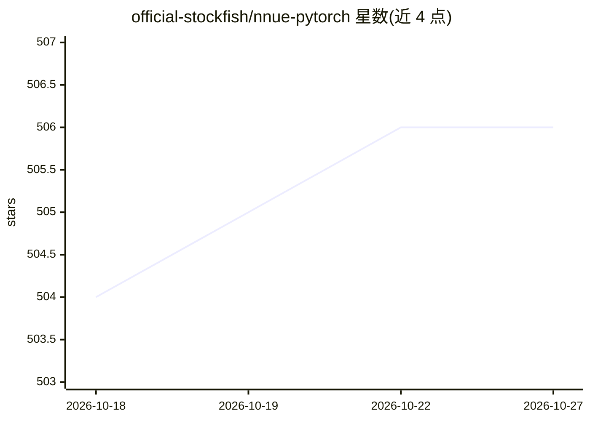

# official-stockfish/nnue-pytorch

⭐ 506 · Python · GPL-3.0 · 推送 2026-10-17 · [GitHub](https://github.com/official-stockfish/nnue-pytorch) · 组织维护

**Stockfish NNUE 国际象棋评估网络的 PyTorch 训练器**

由 Stockfish 官方维护的 NNUE 神经网络训练工具：用 PyTorch 从棋局数据训练 Stockfish 引擎所用的局面评估网络，覆盖数据加载、训练流程与引擎交叉测试。安装以 Docker（PyTorch 容器，含 CUDA/ROCm 依赖）为主路径，Apple Silicon 走 conda 环境加 pip 安装并需运行 setup 脚本。GPU 训练需至少 16GB 内存与 8GB 显存，完整训练数据集约需 800GB 存储；容器构建占用约 30-60GB 磁盘。

## 筛选速览

| 维度 | 判定 | 备注 |
|---|---|---|
| AI 角色 | `ai-native` | 本体是模型或模型工具 |
| 许可风险 | `viral` | GPL-3.0 |
| 部署形态 | `library` | 以包/库形式分发 |
| 模型依赖 | — | README 未给出锁定关系 |
| 硬件要求 | `gpu-8g` | |
| 安装摩擦 | `medium` | 含编译或系统依赖之一 |
| 成熟度 | — | 结构信号不足 |

## 能力要点

- PyTorch 实现 NNUE 评估网络训练
- Docker 容器内置 CUDA 13.x / ROCm 10.1 及全部依赖
- 支持 NVIDIA / AMD / Apple Silicon MPS / CPU-only 多种环境
- 提供训练管线测试与 Stockfish 评估交叉验证

## 适用场景

- 为 Stockfish 引擎训练自定义 NNUE 评估网络
- 复现官方训练流程并做引擎交叉测试
- 在 NVIDIA/AMD/Apple Silicon 环境下进行可复现训练

## 场景标签

`模型训练` · 领域:训练与推理

## 证据(README 行号)

> L1: # NNUE PyTorch
> L70: ## Network training and testing

## 星数曲线

2026-10-18 504 → 2026-10-27 506（+2）

---
*卡片 v1 · prompt 1.4 · 生成 2026-10-21 · 置信度 high · 依据 README sha `e32090dcadfa` · [字段定义](../../DATASET.md)*
