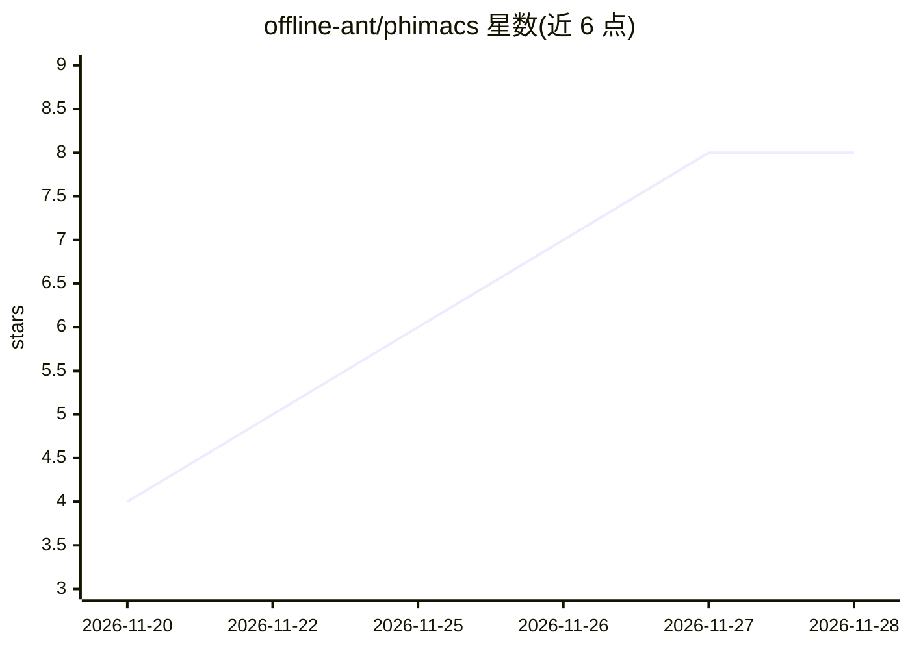

# offline-ant/phimacs

⭐ 8 · Emacs Lisp · MIT · 推送 2026-11-19 · [GitHub](https://github.com/offline-ant/phimacs) · 个人维护

**给 Pi 编码 Agent 用的 Emacs 工作区：项目空间与并行 worker 管理**

作者将自己使用 Pi 编码 Agent 的 Emacs 配置打包成仓库，提供项目空间（每项目独立窗口布局与侧栏）、后台服务 pimux（关闭 Emacs 或断开 SSH 后 agent 继续运行，重启后聊天恢复为 idle）、worker 编排（do 分叉当前聊天、delegate 新建仅带简报的 agent）、可见终端以及实验性的手机端 Tau 查看。作者声明全部代码由 AI agent 编写，仅维护自身用例，版本 0.1.0，仅支持 Linux，测试于 Pi 1.5.2。

## 筛选速览

| 维度 | 判定 | 备注 |
|---|---|---|
| AI 角色 | `ai-ecosystem` | LLM/agent 周边工具 |
| 许可风险 | `permissive` | MIT |
| 部署形态 | `None` |  |
| 模型依赖 | — | README 未给出锁定关系 |
| 硬件要求 | — | 无带数字的原话,不猜 |
| 安装摩擦 | `low` | 无编译、无系统依赖或容器化 |
| 成熟度 | `idea` | |

## 能力要点

- pimux 后台服务使 agent 在关闭 Emacs 或断开 SSH 后继续运行
- worker 编排：do 分叉聊天、delegate 按简报新建 agent、fresh_look 不带上下文
- 每个项目独立空间与侧栏，标示需要用户介入的 agent
- 同一运行中聊天可在 Emacs 与手机浏览器 Tau 中查看

## 适用场景

- 在 Emacs 中同时管理多个 Pi 编码 agent 与并行 worker
- SSH 断开后让长任务 agent 继续运行并从手机查看
- 让 agent 把子任务分派给并行 worker 汇总结果

## 场景标签

`编码 Agent` · 领域:编码与开发

## 证据(README 行号)

> L20: Phimacs is my opinionated setup for Pi
> L26: I work with my agents in Emacs, but Emacs doesn't run them. A background
> L66: |orchestration|`do`, `microdo`, `delegate`: give a task to a worker. `panel-start`, `panel-read`, `panel-send`, `pa

## 星数曲线

2026-11-20 4 → 2026-11-28 8（+4）

---
*卡片 v1 · prompt 1.4 · 生成 2026-11-21 · 置信度 high · 依据 README sha `86fd08f63b94` · [字段定义](../../DATASET.md)*
