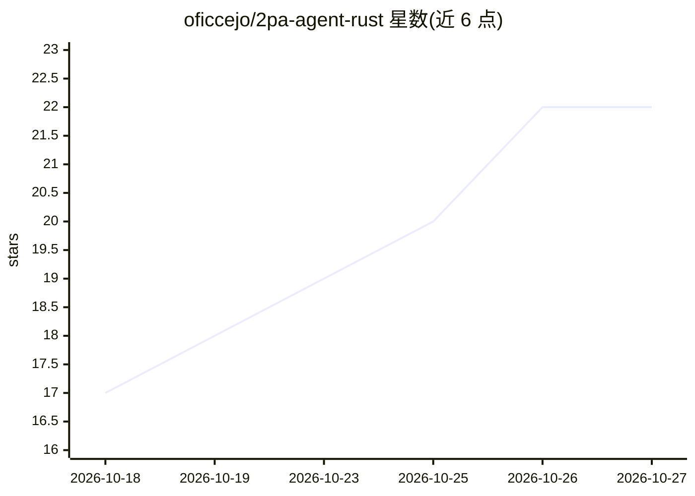

# oficcejo/2pa-agent-rust

⭐ 22 · Rust · NOASSERTION · 推送 2026-10-26 · [GitHub](https://github.com/oficcejo/2pa-agent-rust) · [官网](https://discord.gg/jk4mnW53gK) · 个人维护 · 中文 README

**OKX 日内量化交易系统，LLM 两阶段分析、程序风控执行**

基于 Rust/Axum/Tokio 的 OKX 交易研究与执行工具：LLM 负责两阶段分析与提案，程序基于已收盘行情、结构、成本与账户额度决定是否执行；内置 2PA 趋势、遛狗回归/顺势三策略，附带 TypeSafe 置信度门控、回测引擎、Web 控制台与默认关闭的自进化闭环（成交回执对账、经验库、提示词版本化发布/激活/回退）。提供 Windows 二进制、源码构建与 Docker Compose 三种运行方式；AGPL v3 开源，声明仅用于策略研究、测试通过不代表盈利。

## 筛选速览

| 维度 | 判定 | 备注 |
|---|---|---|
| AI 角色 | `ai-native` | 本体是模型或模型工具 |
| 许可风险 | `none` | NOASSERTION |
| 部署形态 | `desktop` | 安装包/桌面程序 |
| 模型依赖 | — | README 未给出锁定关系 |
| 硬件要求 | — | 无带数字的原话,不猜 |
| 安装摩擦 | `low` | 无编译、无系统依赖或容器化 |
| 成熟度 | — | 结构信号不足 |

## 能力要点

- LLM 提案 + 程序确定性风控校验（入场/止损/净盈亏比≥1.5）的分工执行
- 自进化闭环：signal_id 对账真实成交结果，提示词版本化且须通过选择性发布校验才可激活，默认关闭
- 三策略拆分（2pa_trend / dog_reversion / dog_trend）与高周期趋势过滤
- Web 控制台含行情图表、持仓委托、持续学习面板与历史审计，API 全部鉴权

## 适用场景

- 在 OKX 模拟盘上研究生成日内交易信号并审查执行依据
- 通过 Web 面板管理策略切换、自动交易时段与风险参数
- 利用提示词版本化与成交对账做策略迭代实验

## 场景标签

`金融量化` · 领域:学习与行业

## 证据(README 行号)

> L8: 基于 Rust、Axum 和 Tokio 的 OKX 交易研究与执行工具，支持 LLM 两阶段分析、Web 控制台、自动交易时段，以及默认关闭的自进化闭环。模型负责解释和提出方案，程序根据已收盘行情、结构、成本和账户额度决定是否允许
> L10: 当前版本 **v0.7.0**，策略协议 **2026-09-v1**。规则阈值是研究基线，测试通过不代表策略已经实现盈利。

## 星数曲线

2026-10-18 17 → 2026-10-27 22（+5）

---
*卡片 v1 · prompt 1.4 · 生成 2026-10-27 · 置信度 high · 依据 README sha `9eae3791558a` · [字段定义](../../DATASET.md)*
