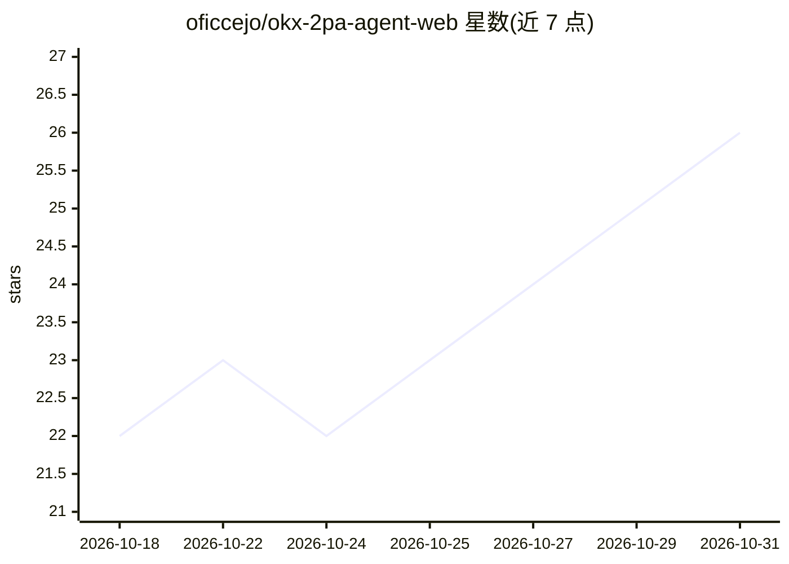

# oficcejo/okx-2pa-agent-web

⭐ 26 · Python · NOASSERTION · 推送 2026-09-19 · [GitHub](https://github.com/oficcejo/okx-2pa-agent-web) · [官网](https://2pa.zhongdu.net) · 个人维护 · 中文 README

**面向 OKX 的 AI 两阶段价格行为自动交易 Web 程序**

从 OKX 获取加密货币及黄金、原油、美股等 TradFi 行情，通过任意 OpenAI 兼容 LLM（DeepSeek、LongCat 等，经 .env 配置）完成两阶段价格行为分析，经数量、信号时效、持仓状态和实盘三重解锁等风控检查后提交订单。支持手动分析、后台自动交易、分析时段预设、杠杆与持仓模式配置，订单与决策留有日志记录。Python 3.11+ 运行，另有 Rust 重构的 Win11 单文件版本在独立仓库发布。README 明确声明不构成投资建议，可能造成资金损失。

## 筛选速览

| 维度 | 判定 | 备注 |
|---|---|---|
| AI 角色 | `ai-native` | 本体是模型或模型工具 |
| 许可风险 | `none` | NOASSERTION |
| 部署形态 | `desktop` | 安装包/桌面程序 |
| 模型依赖 | — | README 未给出锁定关系 |
| 硬件要求 | — | 无带数字的原话,不猜 |
| 安装摩擦 | `low` | 无编译、无系统依赖或容器化 |
| 成熟度 | — | 结构信号不足 |

## 能力要点

- 两阶段价格行为分析，支持任意 OpenAI 兼容 LLM 服务
- 模拟盘/实盘三重解锁与信号时效、持仓状态等风控检查
- 自动分析时段预设（美股/伦敦/亚洲/自定义 IANA 时区）
- 订单审计日志与决策记录（logs/okx_orders.jsonl、records/pending/）

## 适用场景

- 在 OKX 现货、永续合约和 TradFi 品种上运行 AI 自动盯盘与下单
- 先用模拟盘验证 AI 交易策略再切换实盘
- 按美股/伦敦/亚洲时段自动限制分析交易窗口

## 场景标签

`金融量化` · 领域:学习与行业

## 证据(README 行号)

> L3: `okx-2pa-agent-web` 是一个面向 OKX 的 AI 交易 Web 程序。程序从 OKX 获取加密货币及 OKX 已支持的 TradFi 产品行情，支持黄金、原油、美股等，通过 OpenAI 兼容 LLM 完成两阶段
> L22: - OpenAI 兼容 LLM 两阶段价格行为分析
> L26: - 后台自动分析与自动交易

## 星数曲线

2026-10-18 22 → 2026-10-31 26（+4）

---
*卡片 v1 · prompt 1.4 · 生成 2026-10-27 · 置信度 high · 依据 README sha `e51b0b8339e5` · [字段定义](../../DATASET.md)*
