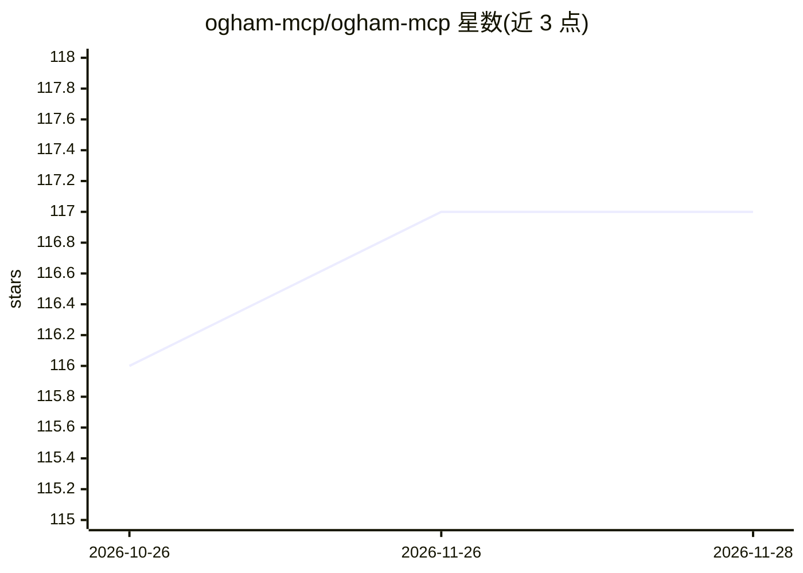

# ogham-mcp/ogham-mcp

⭐ 117 · Python · MIT · 推送 2026-11-25 · [GitHub](https://github.com/ogham-mcp/ogham-mcp) · [官网](https://ogham-mcp.dev) · 个人维护

**给 AI 编码代理提供跨客户端持久共享记忆的 MCP 服务器**

基于 MCP 协议的记忆服务器：将代理会话中的决策、事实、偏好存入 Postgres（Supabase/Neon/自托管），检索采用 pgvector 余弦相似度与 PostgreSQL 全文搜索经 RRF 融合的混合搜索，配合递归 CTE 遍历的类型边知识图谱。通过 `ogham init` 向导连接数据库、选择嵌入提供商并写入 MCP 客户端配置；默认 stdio 传输，也支持 HTTP 多代理共享实例。需先准备一个数据库；README 引用了自建与第三方基准的检索与问答数值。

## 筛选速览

| 维度 | 判定 | 备注 |
|---|---|---|
| AI 角色 | `ai-ecosystem` | LLM/agent 周边工具 |
| 许可风险 | `permissive` | MIT |
| 部署形态 | `self-host` | docker 或自建部署 |
| 模型依赖 | local-ok | 支持本地模型 |
| 硬件要求 | — | 无带数字的原话,不猜 |
| 安装摩擦 | `low` | 无编译、无系统依赖或容器化 |
| 成熟度 | — | 结构信号不足 |

## 能力要点

- 混合检索：pgvector + tsvector 经 RRF 融合，单条 Postgres 查询
- 类型边知识图谱支持两事实 join 查询，无需独立图数据库
- stdio 与 Streamable HTTP 传输，多代理可共享同一服务器实例
- 支持 ONNX 本地嵌入（BGE-M3）与五种嵌入提供商

## 适用场景

- 在 Claude Code、Cursor、OpenCode 等客户端间共享项目上下文
- 让代理跨会话记住决策与坑点，减少重复解释
- 自托管场景下用本地嵌入实现数据不出域的记忆存储

## 场景标签

`Agent 记忆` · 领域:Agent 开发

## 证据(README 行号)

> L14: Ogham gives your agents one shared memory that persists across sessions and clients. It is a **retrieval engine**: 
> L24: `ogham init` runs a setup wizard: it connects your database, picks an embedding provider, migrates the schema, and 
> L187:     | stdio or SSE (MCP protocol)

## 星数曲线

2026-10-26 116 → 2026-11-28 117（+1）

---
*卡片 v1 · prompt 1.4 · 生成 2026-11-28 · 置信度 mid · 依据 README sha `5761d2bf1b08` · [字段定义](../../DATASET.md)*
