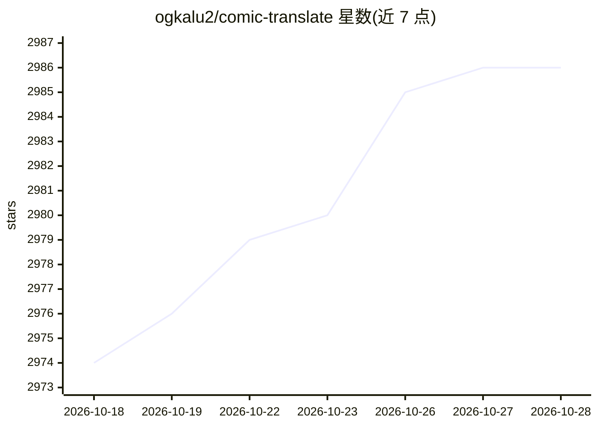

# ogkalu2/comic-translate

⭐ 2,987 · Python · Apache-2.0 · 推送 2026-10-26 · [GitHub](https://github.com/ogkalu2/comic-translate) · [官网](https://comic-translate.com) · 个人维护 · 中文 README

**自动翻译漫画/BD等漫画类作品的桌面应用与浏览器扩展**

面向漫画读者的翻译应用：支持英语、韩语、日语、法语、中文、俄语等多语言漫画（Manga、Manhwa、BD、Fumetti 等），处理图片、PDF、EPUB、CBR/CBZ 等格式。流程为气泡检测（RT-DETR-v2）→ OCR（manga-ocr/Pororo/PPOCRv5，可选 Gemini、Azure Vision）→ 修复（lama、AOT-GAN）→ 翻译（GPT-4.1、Claude-4.5、Gemini-2.5）→ 文字渲染。提供 Windows/macOS 桌面安装包、Chromium 浏览器扩展与源码运行（Python 3.12 + uv）；GPU 加速目前仅限源码运行；v2.0 提供手动修正模式。

## 筛选速览

| 维度 | 判定 | 备注 |
|---|---|---|
| AI 角色 | `ai-native` | 本体是模型或模型工具 |
| 许可风险 | `permissive` | Apache-2.0 |
| 部署形态 | `desktop` | 安装包/桌面程序 |
| 模型依赖 | locked-api |  |
| 硬件要求 | — | 无带数字的原话,不猜 |
| 安装摩擦 | `low` | 无编译、无系统依赖或容器化 |
| 成熟度 | — | 结构信号不足 |

## 能力要点

- 检测-OCR-修复-翻译-渲染的自动化漫画翻译流水线
- 多语言源与多格式支持（图片/PDF/EPUB/CBR/CBZ）
- 可选 GPT-4.1、Claude-4.5、Gemini-2.5 作为翻译模型
- Windows/macOS 桌面安装包与 Chromium 浏览器扩展

## 适用场景

- 把外语漫画自动翻译成我的语言后阅读
- 在漫画网站上通过浏览器扩展直接阅读翻译内容
- OCR 或清理出错时切换手动模式逐张修正

## 场景标签

`OCR` `图像视频处理` · 领域:感知与多模态

## 证据(README 行号)

> L113: ### Speech Bubble Detection and Text Segmentation
> L136: Currently, this supports using GPT-4.1, Claude-4.5,

## 星数曲线

2026-10-18 2,974 → 2026-10-28 2,986（+12）

---
*卡片 v1 · prompt 1.4 · 生成 2026-10-20 · 置信度 mid · 依据 README sha `ebfd1a3d4466` · [字段定义](../../DATASET.md)*
