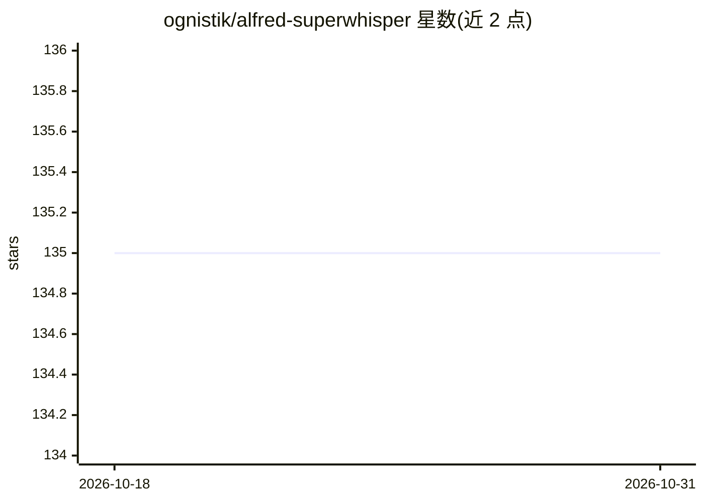

# ognistik/alfred-superwhisper

⭐ 135 · JavaScript · 推送 2026-01-01 · [GitHub](https://github.com/ognistik/alfred-superwhisper) · 个人维护

**用 Alfred 控制 Superwhisper 语音转文字的 macOS 工作流**

非官方的 Alfred workflow，用于控制 Superwhisper（AI 语音转文字工具）：从 Alfred 启动/停止录音、切换录音模式、打开设置、查看与过滤录音历史（按结果/语音/日期）、复制或重处理最近结果、用 Alfred Text View 解析 Superwhisper 的 JSON 文件。支持自定义热键、两个收藏模式、模糊搜索过滤，以及可通过 AppleScript/URL scheme 调用的外部触发器（sw）实现自动化；内置 copySelect CLI 用于自动复制选中文本作为 AI 上下文。要求 Superwhisper 处于运行状态，需手动配置到 Alfred；作者声明非官方，Superwhisper 更新后可能需要调整。附带与 Keyboard Maestro 配合的 Macrowhisper（实验性）。面向使用 Superwhisper 进行听写的 macOS 用户。

## 筛选速览

| 维度 | 判定 | 备注 |
|---|---|---|
| AI 角色 | `ai-ecosystem` | LLM/agent 周边工具 |
| 许可风险 | `none` | — |
| 部署形态 | `None` |  |
| 模型依赖 | — | README 未给出锁定关系 |
| 硬件要求 | — | 无带数字的原话,不猜 |
| 安装摩擦 | `low` | 无编译、无系统依赖或容器化 |
| 成熟度 | — | 结构信号不足 |

## 能力要点

- 从 Alfred 控制 Superwhisper 录音、模式切换与设置
- 录音历史按结果/语音/日期过滤并支持重处理音频
- 外部触发器（sw）经 AppleScript/URL scheme 实现自动化控制
- 内置 copySelect CLI 自动复制选中文本作为 AI 上下文

## 适用场景

- 在 Alfred 里快速启停听写并切换录音模式
- 查看、过滤与重处理 Superwhisper 的历史听写结果
- 通过外部触发器和 Karabiner-Elements 定制听写快捷键与自动化

## 场景标签

`语音识别` · 领域:感知与多模态

## 证据(README 行号)

> L2:  Use Alfred to Control Superwhisper - AI Powered Voice to Text
> L7: This Alfred workflow is designed to enhance your experience with Superwhisper, an INCREDIBLE AI-powered text tool th

## 星数曲线

2026-10-18 135 → 2026-10-31 135（+0）

---
*卡片 v1 · prompt 1.4 · 生成 2026-10-22 · 置信度 mid · 依据 README sha `4eccdf9f02e4` · [字段定义](../../DATASET.md)*
