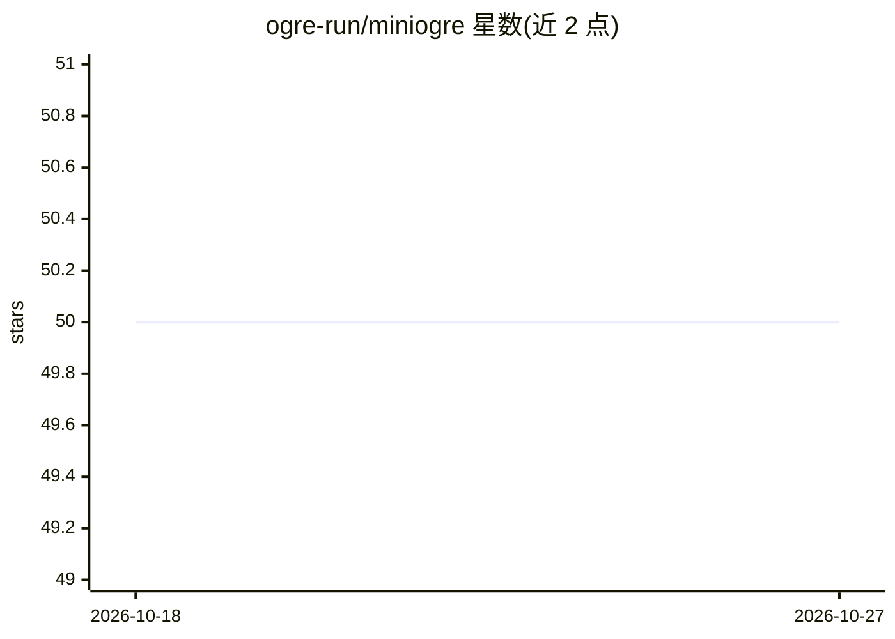

# ogre-run/miniogre

⭐ 50 · Python · Apache-2.0 · 推送 2025-11-04 · [GitHub](https://github.com/ogre-run/miniogre) · [官网](https://docs.ogre.run) · 组织维护

**AI 辅助生成 Python 项目环境与文档文件（Dockerfile/requirements/SBOM）的 CLI 工具**

面向 Python 开发者的命令行工具：分析源码的 import 语句生成依赖列表，用 uv pip compile 锁定 requirements.txt，并可调用用户选择的 LLM（OpenAI/Mistral/Groq/OctoAI）精炼依赖，随后生成 Dockerfile、SBOM（sbom.json），可选构建 Docker 镜像并启动容器。另提供 readme 生成/更新、README 质量评分（1-10 分）、云上传等子命令。需 Python 3.10+、Docker 与至少一个 LLM API key。目前针对 Python 项目优化。

## 筛选速览

| 维度 | 判定 | 备注 |
|---|---|---|
| AI 角色 | `ai-enhanced` | 去掉 AI 部分产品仍成立 |
| 许可风险 | `permissive` | Apache-2.0 |
| 部署形态 | `self-host` | docker 或自建部署 |
| 模型依赖 | locked-api |  |
| 硬件要求 | — | 无带数字的原话,不猜 |
| 安装摩擦 | `low` | 无编译、无系统依赖或容器化 |
| 成熟度 | `idea` | |

## 能力要点

- 分析源码 import 生成 requirements.txt（uv pip compile 锁定）
- 生成 Dockerfile 与 SBOM（sbom.json）并可选构建/启动容器
- 支持 OpenAI/Mistral/Groq/OctoAI 多家 LLM 提供商
- readme 子命令基于源码分析生成或更新 README，eval 子命令按 1-10 分评估 README 质量

## 适用场景

- 为 Python 项目快速生成可复现的容器化环境文件
- 自动生成/更新项目的依赖清单与 SBOM
- 让 AI 根据源码现状改写 README 并评估其质量

## 场景标签

`代码生成` · 领域:编码与开发

## 证据(README 行号)

> L3: **miniogre** is a command-line tool that helps developers automate the process of setting up reproducible Python env
> L18: 4. **Refines the requirements:** miniogre leverages a Large Language Model (LLM) of your choice (OpenAI, Mistral, G

## 星数曲线

2026-10-18 50 → 2026-10-27 50（+0）

---
*卡片 v1 · prompt 1.4 · 生成 2026-10-24 · 置信度 mid · 依据 README sha `9e8489a01c59` · [字段定义](../../DATASET.md)*
