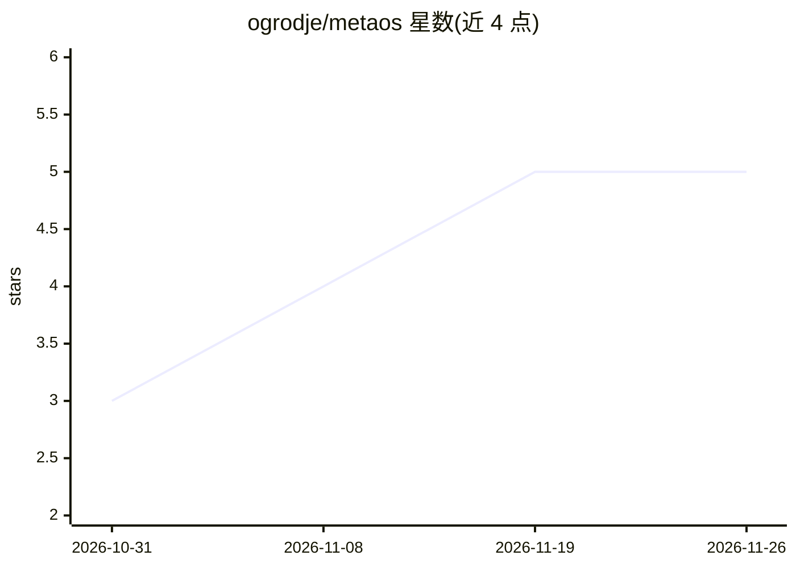

# ogrodje/metaos

⭐ 5 · Kotlin · 推送 2026-11-25 · [GitHub](https://github.com/ogrodje/metaos) · [官网](https://ogrodje.si) · 组织维护

**为 Ogrodje 媒体组织提供代理化运营管理框架**

面向媒体组织（播客/社区）的自主代理式管理与运营框架：通过 Web 前端或 MCP 供 AI 助手访问，数据存于 Postgres，对接 Google Drive、Koofr、Dropbox、Patreon 等外部服务；定时抓取斯洛文尼亚科技活动（Meetup、Eventbrite、iCal、Luma 等），在 Temporal 持久化工作流中执行长任务（如经 Google Speech-to-Text 或 Soniox 转录单集音频），经 headless Chromium 操作 Patreon 发布草稿。部署于 Kubernetes，使用 Nix/devenv 做开发环境隔离。

## 筛选速览

| 维度 | 判定 | 备注 |
|---|---|---|
| AI 角色 | `ai-enhanced` | 去掉 AI 部分产品仍成立 |
| 许可风险 | `none` | — |
| 部署形态 | `None` |  |
| 模型依赖 | locked-api |  |
| 硬件要求 | — | 无带数字的原话,不猜 |
| 安装摩擦 | `low` | 无编译、无系统依赖或容器化 |
| 成熟度 | — | 结构信号不足 |

## 能力要点

- 通过 MCP 端点供 Claude Code、Codex、ChatGPT 等 AI 助手接入操作
- Temporal 持久化工作流承载转录、Patreon 自动起草等长任务
- 每小时抓取聚合科技活动（Meetup/Eventbrite/iCal/Luma）
- Kubernetes 部署，配套 Unleash 特性开关与 New Relic/Prometheus 监控

## 适用场景

- 让 AI 助手通过 MCP 直接管理媒体组织的剧集与素材
- 自动化播客单集的转录与 Patreon 草稿发布流程
- 聚合展示本地科技开发者创业活动

## 场景标签

`工作流自动化` `Agent 框架` · 领域:Agent 开发

## 证据(README 行号)

> L3: MetaOS is an autonomous, agentic framework for managing and operating media organisations.
> L11: People use MetaOS through its web front-end or from an AI assistant over MCP. The front-end is a Nuxt server of its
> L30: API and the uploads go straight to Patreon. What takes long, like transcribing an episode, MetaOS does in durable

## 星数曲线

2026-10-31 3 → 2026-11-26 5（+2）

---
*卡片 v1 · prompt 1.4 · 生成 2026-11-21 · 置信度 high · 依据 README sha `c2a7be79592f` · [字段定义](../../DATASET.md)*
