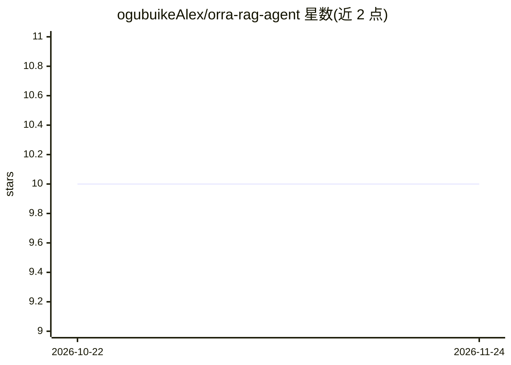

# ogubuikeAlex/orra-rag-agent

⭐ 10 · Python · 推送 2026-05-19 · [GitHub](https://github.com/ogubuikeAlex/orra-rag-agent) · 个人维护

**查询 ORRA 文档与 FAQ 的企业 RAG API 服务**

为 ORRA 构建的企业 AI agent，以 FastAPI 提供 REST API 服务：POST /v1/retrieve 与 /v1/query 接口查询本地 docs 目录文档与 GitHub Gist 托管的 FAQ JSON，检索层采用 LanceDB 混合搜索，答案生成可选使用 Gemini，缺失 API key 时检索仍可用；提供 RAGAS 评估端点（需安装可选 eval extra）对线上流水线跑评测样本，索引启动时自动构建并支持接口强制重建。

## 筛选速览

| 维度 | 判定 | 备注 |
|---|---|---|
| AI 角色 | `ai-native` | 本体是模型或模型工具 |
| 许可风险 | `none` | — |
| 部署形态 | `None` |  |
| 模型依赖 | — | README 未给出锁定关系 |
| 硬件要求 | — | 无带数字的原话,不猜 |
| 安装摩擦 | `low` | 无编译、无系统依赖或容器化 |
| 成熟度 | — | 结构信号不足 |

## 能力要点

- LanceDB 混合搜索索引本地文档，GitHub Gist 提供实时 FAQ 来源
- Gemini 可选答案生成，无 GOOGLE_API_KEY 时仍可检索
- RAGAS 评估端点评测线上检索流水线
- 索引自动构建并提供 /v1/index/rebuild 重建接口

## 适用场景

- 为 ORRA UI 搜索提供文档与 FAQ 检索后端
- 用 RAGAS 评估自己的检索流水线质量
- 将文档问答 API 接入自己的项目

## 场景标签

`RAG` `文档问答` `模型评测` · 领域:评测与运维

## 证据(README 行号)

> L3: `orra-rag-agent` is a hybrid enterprise AI agent built for ORRA. It utilizes a robust, RAGAS-evaluated retrieval pip
> L10: - LanceDB hybrid search for indexed documentation

## 星数曲线

2026-10-22 10 → 2026-11-24 10（+0）

---
*卡片 v1 · prompt 1.4 · 生成 2026-11-19 · 置信度 high · 依据 README sha `3e9bf3109313` · [字段定义](../../DATASET.md)*
