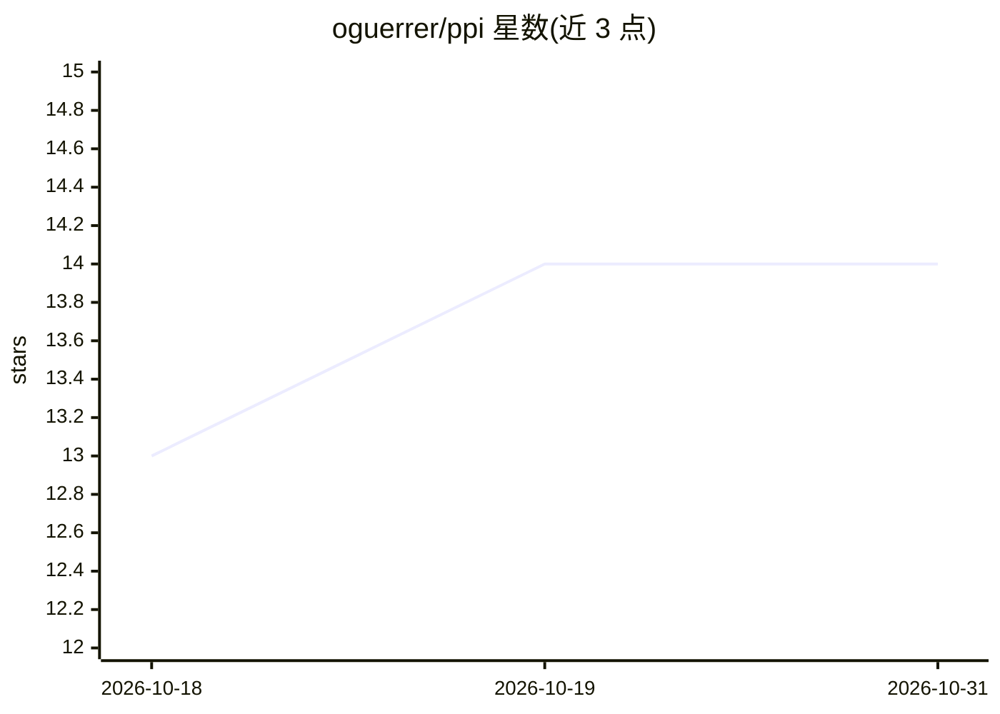

# oguerrer/ppi

⭐ 14 · Jupyter Notebook · MIT · 推送 2026-03-30 · [GitHub](https://github.com/oguerrer/ppi) · 组织维护

**政策优先级推断（PPI）研究的主体计算模型源码**

由 Guerrero 与 Castañeda 主持的政策优先级推断研究项目的官方仓库，提供 PPI 底层 agent-based 计算模型的最新版本源码，以及入门教程。模型用于政府支出与可持续发展目标相关的政策优先级分析。成果将见于剑桥大学出版社出版的专著，并有 World Development 期刊工作论文版本（Guerrero, Guariso & Castañeda 2023）。README 中未给出安装命令与运行依赖说明。

## 筛选速览

| 维度 | 判定 | 备注 |
|---|---|---|
| AI 角色 | `ai-native` | 本体是模型或模型工具 |
| 许可风险 | `permissive` | MIT |
| 部署形态 | `None` |  |
| 模型依赖 | — | README 未给出锁定关系 |
| 硬件要求 | — | 无带数字的原话,不猜 |
| 安装摩擦 | `low` | 无编译、无系统依赖或容器化 |
| 成熟度 | — | 结构信号不足 |

## 能力要点

- PPI 研究项目官方源码仓库
- 提供 agent-computing 模型最新版本与入门教程
- 关联 World Development 期刊论文（DOI: 10.1016/j.worlddev.2023.106256）

## 适用场景

- 复现或研究政策优先级推断模型
- 学习 agent-based 政策模拟方法
- 跟踪 PPI 研究项目的最新模型版本

## 场景标签

 · 领域:计算经济学/政策模拟

## 证据(README 行号)

> L3: This is the official repository of the Policy Priority Inference (PPI) research programme, created by Dr. Omar A. Gu
> L4: Here you will find the source code of the latest version of the agent-computing model underlying PPI, as well as tut

## 星数曲线

2026-10-18 13 → 2026-10-31 14（+1）

---
*卡片 v1 · prompt 1.4 · 生成 2026-10-31 · 置信度 mid · 依据 README sha `75495b277bf9` · [字段定义](../../DATASET.md)*
