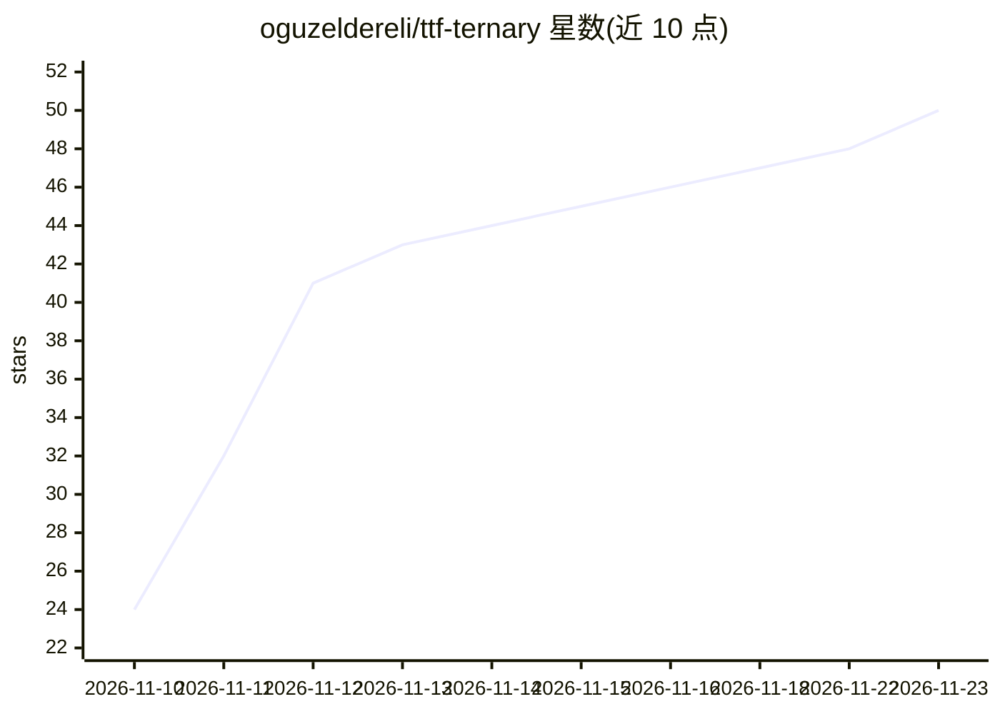

# oguzeldereli/ttf-ternary

⭐ 50 · Python · NOASSERTION · 推送 2026-11-22 · [GitHub](https://github.com/oguzeldereli/ttf-ternary) · 个人维护

**三值 LLM 训练框架：免全精度主权重，约1字节优化器状态/权重**

面向研究者的 ternary {-1,0,1} 大模型训练器：以 two-timescale threshold flips (TTF) 方法在训练全程保持 1.6 比特打包权重，优化器状态为低秩（约每权重 1 字节），支持从零训练 Llama 风格模型与 Qwen3.5/3.8（含 Flash-Next MoE）、从 ttf-conversion 转换的三值检查点继续训练（含蒸馏）、BitNet b1.58 与全精度基线及评测；可将检查点导出为 .ttf 文件或 GGUF。要求 Linux + NVIDIA GPU (CUDA)，Triton 内核使用 int8 tensor cores；训练不支持 macOS/Windows。附论文（LaTeX 源码在 paper/）。

## 筛选速览

| 维度 | 判定 | 备注 |
|---|---|---|
| AI 角色 | `ai-ecosystem` | LLM/agent 周边工具 |
| 许可风险 | `none` | NOASSERTION |
| 部署形态 | `library` | 以包/库形式分发 |
| 模型依赖 | local-ok | 支持本地模型 |
| 硬件要求 | — | 无带数字的原话,不猜 |
| 安装摩擦 | `medium` | 含编译或系统依赖之一 |
| 成熟度 | — | 结构信号不足 |

## 能力要点

- 23B 模型可在单张 16 GB GPU 训练，Qwen3.8-27B 转换后训练用单张 24 GB 卡
- 训练全程权重保持 1.6 比特打包（5 trits/字节），无全精度主权重
- 支持 TTF/BitNet b1.58/全精度三种模式对比训练与评测
- 导出 .ttf（GGUF 容器）由 ttf-home 运行时执行，或导出普通 GGUF 供 llama.cpp

## 适用场景

- 在单张消费级 GPU 上训练或继续训练三值大模型
- 复现论文中的 TTF 与 BitNet b1.58 对照实验
- 将 Qwen 等预训练模型转换为三值检查点并做恢复训练
- 对三值模型做验证损失与 GSM8K/HumanEval 评测

## 场景标签

`模型训练` `模型量化` · 领域:训练与推理

## 证据(README 行号)

> L6: Train ternary ({-1, 0, +1}) language models **without full-precision master weights**. The weights stay packed at 1.
> L22: |**ttf-ternary** (this one)|the trainer: TTF from scratch or from a ternary checkpoint, Llama-style models and Qwen
> L36: - Linux with an NVIDIA GPU (CUDA). The kernels are Triton and use the int8 tensor cores; measured on RTX 3090 Ti,

## 星数曲线

2026-11-10 24 → 2026-11-23 50（+26）

---
*卡片 v1 · prompt 1.4 · 生成 2026-11-18 · 置信度 high · 依据 README sha `2fb25d142163` · [字段定义](../../DATASET.md)*
