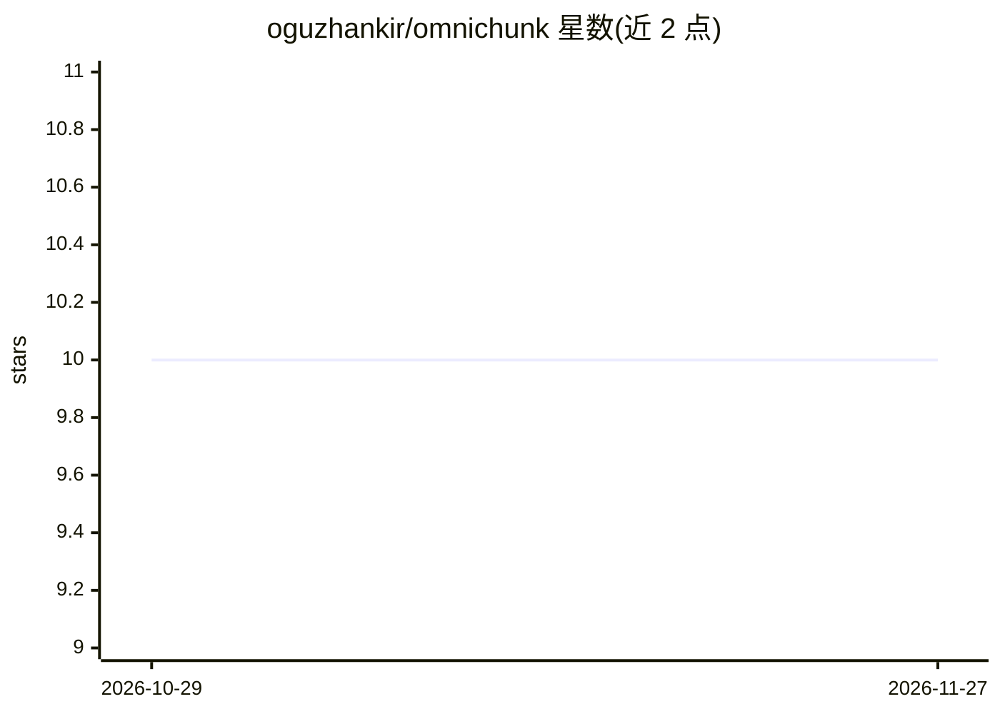

# oguzhankir/omnichunk

⭐ 10 · Python · MIT · 推送 2026-11-03 · [GitHub](https://github.com/oguzhankir/omnichunk) · [官网](https://oguzhankir.github.io/omnichunk) · 个人维护

**面向 RAG 开发者的结构感知文本分块库**

以 Python 库和 CLI 形式提供的结构感知分块工具：读取代码、Markdown、RST、LaTeX、Notebook 等文件，按 AST 边界、标题层级、段落等语义边界切分为带源码范围与元数据的块，支持按 token/字符预算控制大小。零强制依赖的基础安装，AST 解析器与 tokenizer 通过 extras 按需添加；提供 chunk_diff 增量检测、SQLite 投递日志实现索引同步与复用嵌入。当前为 beta 阶段。

## 筛选速览

| 维度 | 判定 | 备注 |
|---|---|---|
| AI 角色 | `ai-ecosystem` | LLM/agent 周边工具 |
| 许可风险 | `permissive` | MIT |
| 部署形态 | `library` | 以包/库形式分发 |
| 模型依赖 | — | README 未给出锁定关系 |
| 硬件要求 | — | 无带数字的原话,不猜 |
| 安装摩擦 | `low` | 无编译、无系统依赖或容器化 |
| 成熟度 | `idea` | |

## 能力要点

- 结构感知分块：保留 AST 边界、标题层级与 import 上下文
- chunk_diff 检测编辑并复用未变更的嵌入
- LangChain / LlamaIndex 原生集成，Qdrant / pgvector 可选 sink
- 零强制依赖的基础安装，15+ 语言语法可通过 extras 扩展

## 适用场景

- 为 RAG 系统生成带出处与元数据的文档/代码块
- 文档或代码变更后增量更新向量索引
- 按下游模型的 token 预算控制分块大小
- CLI 批量切分源码目录并导出 JSONL

## 场景标签

`RAG` · 领域:知识与检索

## 证据(README 行号)

> L3:  Structure-aware chunking for reliable RAG.
> L23: **Local structural processing. No mandatory dependencies in the base install.**
> L91: |**LangChain**|Native `OmniChunkTextSplitter` with chunk IDs, metadata and source references.|

## 星数曲线

2026-10-29 10 → 2026-11-27 10（+0）

---
*卡片 v1 · prompt 1.4 · 生成 2026-11-19 · 置信度 high · 依据 README sha `d72eb4dd42df` · [字段定义](../../DATASET.md)*
