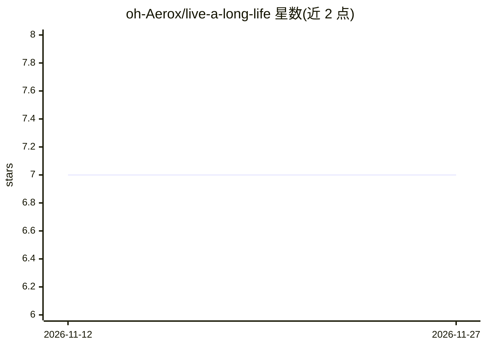

# oh-Aerox/live-a-long-life

⭐ 7 · Dart · GPL-3.0 · 推送 2026-11-12 · [GitHub](https://github.com/oh-Aerox/live-a-long-life) · 个人维护 · 中文 README

**本地优先健康记录应用：聊天式记录饮食睡眠，病历单据结构化留存**

本地优先的个人健康记录应用，手机端像聊天一样收集饮食、睡眠、心情、不适并整理成结构化记录；病历、检验单、体检报告经本机 OCR 预览脱敏后由模型提取，逐项核对并锚定到原件位置，电脑端通过局域网加密同步做归档、加密备份与周报查看。模型由用户自选（多家云端或本机 Ollama），无应用自有服务器。iPhone/Mac 可用，安卓/Windows 适配中；目前经免费开发者签名安装，7 天需重签。

## 筛选速览

| 维度 | 判定 | 备注 |
|---|---|---|
| AI 角色 | `ai-native` | 本体是模型或模型工具 |
| 许可风险 | `viral` | GPL-3.0 |
| 部署形态 | `None` |  |
| 模型依赖 | local-ok | 支持本地模型 |
| 硬件要求 | — | 无带数字的原话,不猜 |
| 安装摩擦 | `low` | 无编译、无系统依赖或容器化 |
| 成熟度 | `idea` | |

## 能力要点

- 聊天式记录由模型自动整理为结构化条目，修改历史保留
- 病历/检验单先本机识别（Apple Vision）并遮蔽敏感信息，确认后才发模型
- 提取结果逐项核对，每个数值可跳回原件高亮定位
- 手机与电脑局域网双向认证加密同步，数据存本地 SQLite

## 适用场景

- 用聊天方式每天记录饮食、睡眠和身体不适
- 把历年体检报告和病历整理成可追踪趋势的结构化数据
- 在不上传数据到第三方服务器的前提下做健康周报总结
- 向模型咨询个人健康问题时限定其只查阅已核对的记录

## 场景标签

`文档解析` · 领域:知识与检索

## 证据(README 行号)

> L3: 长命百岁是一款本地优先的个人健康记录应用。它像聊天一样收集你每天的饮食、睡眠、心情、不适和运动，自动整理成结构化记录；把病历、检验单、检查报告变成可核对、可追溯到原件的数据；每周生成周报，帮你看清长期的变化。
> L5: 数据保存在你自己的设备上。手机负责记录，电脑负责分析和归档，两者在同一个局域网内加密同步。是否使用模型、使用哪家的模型、模型跑在本机还是云端，都由你决定。
> L76: - **模型由你选择**：支持 OpenAI、Anthropic、DeepSeek、Kimi、智谱 GLM、Ollama（本机或局域网）和任意 OpenAI 兼容服务，只需填 Base URL 和 Key。每个模型标明数据边界（本

## 星数曲线

2026-11-12 7 → 2026-11-27 7（+0）

---
*卡片 v1 · prompt 1.4 · 生成 2026-11-20 · 置信度 high · 依据 README sha `06d734c5a440` · [字段定义](../../DATASET.md)*
