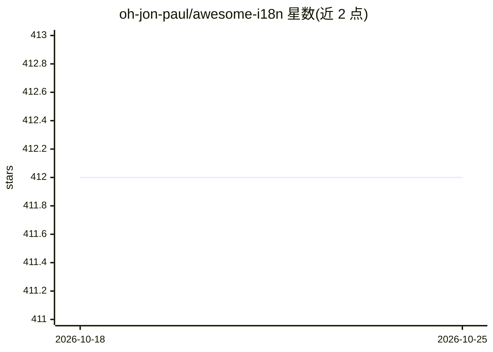

# oh-jon-paul/awesome-i18n

⭐ 412 · 推送 2026-10-21 · [GitHub](https://github.com/oh-jon-paul/awesome-i18n) · 个人维护

**i18n 资源策展清单：收录各语言框架的国际化工具与教程**

面向开发者的 awesome 类清单，收录 i18n 库（JavaScript/TypeScript、React、Angular、Svelte、Vue、Nuxt、Java、Swift、Ruby、Python、Jekyll）、日期电话号码等工具、翻译管理与桌面翻译应用、文本翻译服务及博客/数据集/标准指南等资源。条目按类别组织，贡献规则限定免费项、不收付费/freemium 服务与所谓 AI slop 工具，单条不超过 120 字符。清单本身不提供软件安装，仅收录链接与简介。

## 筛选速览

| 维度 | 判定 | 备注 |
|---|---|---|
| AI 角色 | `ai-knowledge` | 知识聚合/清单类 |
| 许可风险 | `none` | — |
| 部署形态 | `library` | 以包/库形式分发 |
| 模型依赖 | — | README 未给出锁定关系 |
| 硬件要求 | — | 无带数字的原话,不猜 |
| 安装摩擦 | `low` | 无编译、无系统依赖或容器化 |
| 成熟度 | — | 结构信号不足 |

## 能力要点

- 按 10+ 语言/框架类别收录 i18n 库与 CLI 工具
- 收录 LibreTranslate、Argos Translate 等开源翻译应用与自托管方案
- 贡献规则明确排除付费服务与依赖付费服务的库
- 附 hreflang、ICU、W3C i18n 标准等资源与社区技巧

## 适用场景

- 为项目选型查找所用语言/框架的 i18n 库
- 寻找开源离线/自托管翻译工具
- 查阅 i18n 标准与实践指南

## 场景标签

`精选清单` · 领域:学习与行业

## 证据(README 行号)

> L5: > A curated list of i18n tools, i18n libraries, localization software, localization programs and translation managem
> L23: ## 📦 Libraries

## 星数曲线

2026-10-18 412 → 2026-10-25 412（+0）

---
*卡片 v1 · prompt 1.4 · 生成 2026-10-22 · 置信度 mid · 依据 README sha `09e4dea11d38` · [字段定义](../../DATASET.md)*
