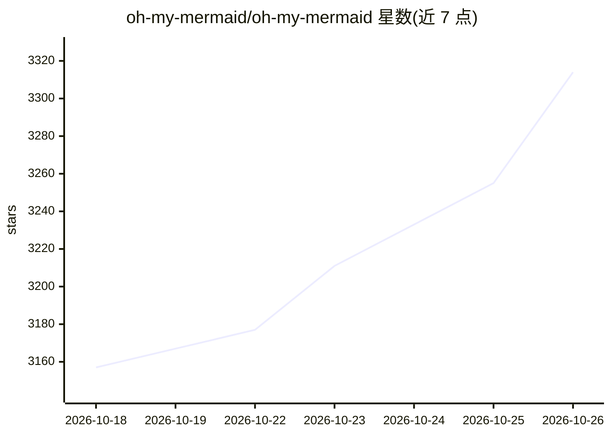

# oh-my-mermaid/oh-my-mermaid

⭐ 3,314 · TypeScript · MIT · 推送 2026-04-07 · [GitHub](https://github.com/oh-my-mermaid/oh-my-mermaid) · 组织维护

**让 Claude Code 等 AI 工具生成代码库架构图与文档的 CLI**

npm 安装的命令行工具，通过注册技能到 AI 编码工具（Claude Code、Codex、Cursor、OpenClaw、Antigravity）实现代码库分析：AI 生成多视角架构文档（结构、数据流、集成等），每个视角含 Mermaid 图与最多 7 个文档字段；复杂节点递归分析为嵌套子元素，目录树反映该结构。提供交互式查看器（omm view）与可选云端存储（ohmymermaid.com，默认私有）。

## 筛选速览

| 维度 | 判定 | 备注 |
|---|---|---|
| AI 角色 | `ai-ecosystem` | LLM/agent 周边工具 |
| 许可风险 | `permissive` | MIT |
| 部署形态 | `library` | 以包/库形式分发 |
| 模型依赖 | locked-api |  |
| 硬件要求 | — | 无带数字的原话,不猜 |
| 安装摩擦 | `low` | 无编译、无系统依赖或容器化 |
| 成熟度 | — | 结构信号不足 |

## 能力要点

- /omm-scan 技能由 AI 分析代码库生成架构文档与 Mermaid 图
- 节点递归分析，复杂节点生成嵌套子图，文件系统反映树结构
- 支持 5 种 AI 编码工具并自动检测配置（omm setup）
- 可选云端存储架构文档（默认私有）

## 适用场景

- 让 Claude Code 等工具扫描代码库生成交互式架构图
- 快速了解不熟悉的代码库结构
- 团队共享架构文档

## 场景标签

 · 领域:开发者工具/代码库文档

## 证据(README 行号)

> L19: npm install -g oh-my-mermaid && omm setup
> L43: Your AI analyzes the codebase and generates **perspectives** — different lenses on your architecture (structure, da
> L92: |Claude Code|`omm setup claude`|

## 星数曲线

2026-10-18 3,157 → 2026-10-26 3,314（+157）

---
*卡片 v1 · prompt 1.4 · 生成 2026-10-20 · 置信度 high · 依据 README sha `17491c5f697e` · [字段定义](../../DATASET.md)*
