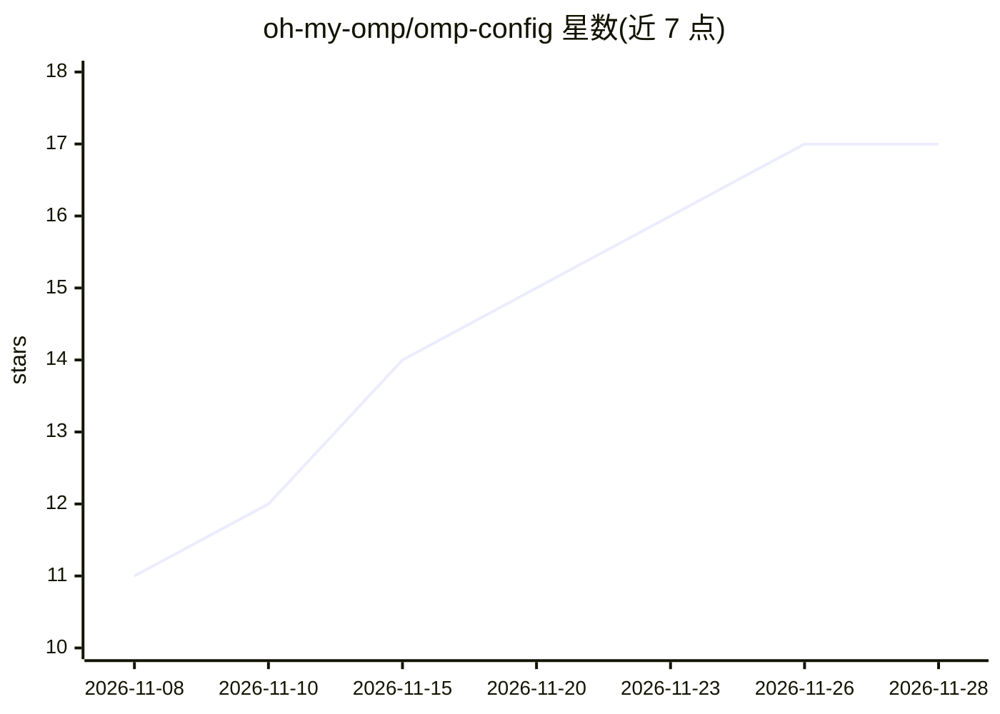

# oh-my-omp/omp-config

⭐ 17 · TypeScript · 推送 2026-11-27 · [GitHub](https://github.com/oh-my-omp/omp-config) · 组织维护 · 中文 README

**Oh My Pi 编码 agent 的版本化配置与插件清单仓库**

为 Oh My Pi（omp）编码 agent 提供版本化的系统提示模板、子代理定义、本地扩展与插件清单。通过 /onboard-omp 引导安装，/update-omp 与 /sync-omp-config 维护仓库与机器间同步，每日 02:00 (GMT+9) 自动发布。设计上消除系统提示重复、以 hashline 编辑约束文件操作、用 tool-policy-nag 等扩展监控提示漂移、按损耗程度排序压缩方法，并按模型互补性组织子代理。面向 omp 用户，以 git clone 加斜杠命令方式使用。

## 筛选速览

| 维度 | 判定 | 备注 |
|---|---|---|
| AI 角色 | `ai-ecosystem` | LLM/agent 周边工具 |
| 许可风险 | `none` | — |
| 部署形态 | `None` |  |
| 模型依赖 | — | README 未给出锁定关系 |
| 硬件要求 | — | 无带数字的原话,不猜 |
| 安装摩擦 | `low` | 无编译、无系统依赖或容器化 |
| 成熟度 | — | 结构信号不足 |

## 能力要点

- 消除系统提示重复：tool-topics 按需下发工具指令，system-prompt-replace 处理措辞级修改
- hashline 编辑模式要求先 read 快照再锚定编辑，禁止 eval 中本地文件查找
- 压缩方法按损耗排序并禁用 32k 早期后台摘要，保留已确认约束
- 子代理按模型互补绑定通道，任务执行用无状态 task runner 编排

## 适用场景

- 为 Oh My Pi agent 安装一套治理与提示工程配置
- 在多机器间同步 agent 配置并接收每日发布更新
- 通过顾问子代理与监控扩展约束长会话中的模型行为

## 场景标签

`提示工程` · 领域:Agent 开发

## 证据(README 行号)

> L7: Use `/onboard-omp` as the installation entry point for omomp. With Oh My Pi (`omp`) already installed, clone this re
> L10: git clone https://github.com/oh-my-omp/omp-config.git

## 星数曲线

2026-11-08 11 → 2026-11-28 17（+6）

---
*卡片 v1 · prompt 1.4 · 生成 2026-11-18 · 置信度 high · 依据 README sha `46577a6d48da` · [字段定义](../../DATASET.md)*
