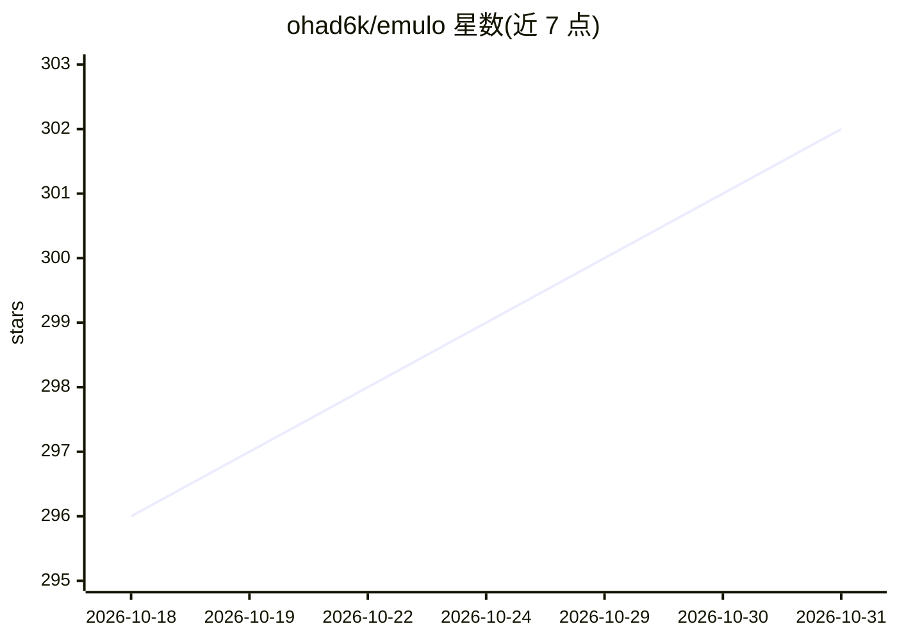

# ohad6k/emulo

⭐ 302 · HTML · MIT · 推送 2026-10-12 · [GitHub](https://github.com/ohad6k/emulo) · [官网](https://emulo.vercel.app) · 个人维护

**从你的 AI 编程代理会话日志挖掘生成 you.md 个人画像**

Python 编写的本地工具，读取 Claude Code、Codex、Copilot CLI、OpenCode、Antigravity 的原始会话日志，只提取用户自己输入的消息，生成带日期引文回执的工作/设计/写作/视频分层画像 you.md，并安装到 AGENTS.md、Claude Code、Cursor、Gemini 等代理可读取的位置。另提供不调用模型的用法报告（统计重复请求等文本匹配）与 card.json 分享卡片。数据默认留在本机，仅指向托管模型时证据会发送给该服务商。作者公开说明画像是否改善代理工作尚未验证，并有安慰剂对照测试未通过分离的记录。

## 筛选速览

| 维度 | 判定 | 备注 |
|---|---|---|
| AI 角色 | `ai-ecosystem` | LLM/agent 周边工具 |
| 许可风险 | `permissive` | MIT |
| 部署形态 | `library` | 以包/库形式分发 |
| 模型依赖 | — | README 未给出锁定关系 |
| 硬件要求 | — | 无带数字的原话,不猜 |
| 安装摩擦 | `low` | 无编译、无系统依赖或容器化 |
| 成熟度 | `idea` | |

## 能力要点

- 从 5 种编程代理会话日志提取带日期引文的规则画像
- 零依赖 Python CLI，含不做模型调用的免费用法报告
- 分层画像（work/design/writing/video）按任务加载，本地处理
- 生成可分享的 card.json 档案卡

## 适用场景

- 把长期积累的编码偏好沉淀成代理可读的配置文件
- 查看自己反复向代理重复哪些请求
- 让代理从首条消息起按自己的工作习惯行事

## 场景标签

`Agent 记忆` · 领域:Agent 开发

## 证据(README 行号)

> L5:  Mine the messages you typed to your coding agents into a you.md profile, every rule with dated receipts, and instal
> L16: Emulo mines selected evidence from those sessions (Claude Code, Codex, Copilot CLI, OpenCode, and Google Antigravit

## 星数曲线

2026-10-18 296 → 2026-10-31 302（+6）

---
*卡片 v1 · prompt 1.4 · 生成 2026-10-21 · 置信度 high · 依据 README sha `45fb065d9723` · [字段定义](../../DATASET.md)*
