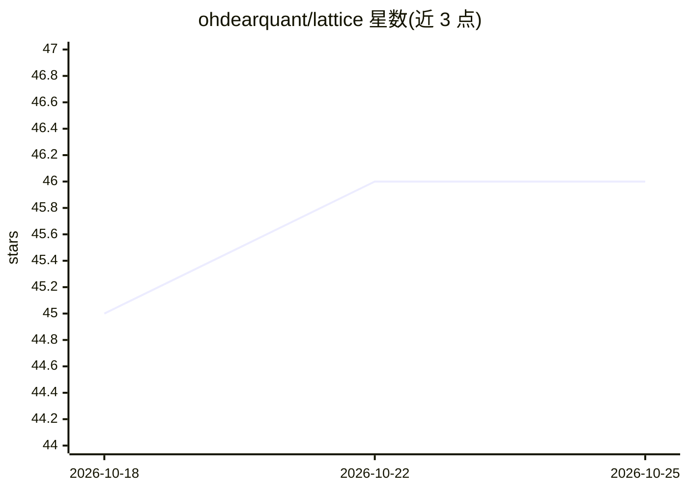

# ohdearquant/lattice

⭐ 46 · Rust · Apache-2.0 · 推送 2026-10-24 · [GitHub](https://github.com/ohdearquant/lattice) · [官网](https://khive.ai) · 个人维护

**纯 Rust 的 Apple Silicon 本地 LLM/嵌入推理引擎与 macOS 工作台**

以纯 Rust 实现完整 transformer 推理计算图的引擎：权重加载、分词、前向传播、量化、LoRA 训练均在 Rust 内完成，无 ONNX/Python/CUDA/外部 ML 运行时；用 Metal MSL shader 在 Apple Silicon 上加速，CPU 路径走 AVX2/NEON SIMD，并有 WGPU 跨平台回退。仓库含十个 crate（嵌入、生成、量化、LoRA 微调、最优传输等），`lattice` 二进制提供交互式聊天与 OpenAI 兼容 HTTP 服务；另含 Lattice Studio 原生 macOS 应用（需按文档自行构建）。支持 Qwen3.5/Qwen3.6 生成模型与 BGE/E5/MiniLM/Qwen3-Embedding 等 9 个嵌入模型，覆盖 Q8/Q4/QuaRot 量化、推测解码、语法约束解码与 KV 缓存。限制：跨引擎解码基准表因报告脚本算术错误已撤回，蒸馏的在线教师通道尚未接通。

## 筛选速览

| 维度 | 判定 | 备注 |
|---|---|---|
| AI 角色 | `ai-ecosystem` | LLM/agent 周边工具 |
| 许可风险 | `permissive` | Apache-2.0 |
| 部署形态 | `desktop` | 安装包/桌面程序 |
| 模型依赖 | — | README 未给出锁定关系 |
| 硬件要求 | `cpu-ok` | |
| 安装摩擦 | `high` | 编译与系统依赖俱全 |
| 成熟度 | — | 结构信号不足 |

## 能力要点

- 纯 Rust 实现 tokenization/前向/量化/LoRA 全链路，无 Python/ONNX/CUDA 依赖
- Metal GPU 后端 + AVX2/NEON SIMD + WGPU 跨平台回退
- OpenAI 兼容 /v1/chat/completions HTTP 服务与交互式 CLI
- QuaRot 旋转式 4-bit 量化与 Q4+LoRA 推理、语法约束解码

## 适用场景

- 在 Mac 上本地运行 Qwen 系列生成模型与嵌入模型
- 以库形式在 Rust 项目中集成嵌入/推理能力
- 通过 LoRA 微调与量化在 Apple Silicon 上管理自有模型

## 场景标签

`推理引擎` `模型量化` `微调` · 领域:训练与推理

## 证据(README 行号)

> L20: **A Rust inference library.** Ten crates covering embeddings, generation, quantization,
> L41: |HTTP API|OpenAI-compatible `/v1/chat/completions` via `lattice serve`.|

## 星数曲线

2026-10-18 45 → 2026-10-25 46（+1）

---
*卡片 v1 · prompt 1.4 · 生成 2026-10-25 · 置信度 mid · 依据 README sha `e25a3a23ef55` · [字段定义](../../DATASET.md)*
