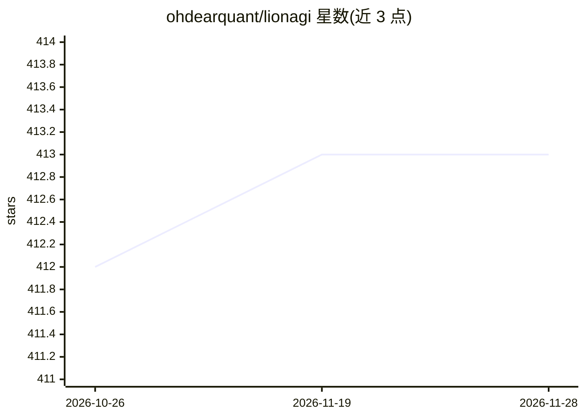

# ohdearquant/lionagi

⭐ 413 · Python · Apache-2.0 · 推送 2026-11-27 · [GitHub](https://github.com/ohdearquant/lionagi) · [官网](https://khive.ai) · 组织维护

**Python 多智能体编排框架，提供 CLI、类型化状态与治理机制**

lionagi 定位为受治理的多智能体编排框架：以 Python API（Branch/Session/flow/team）和 li CLI 构建智能体工作流，支持单智能体、并行扇出和由编排者规划 DAG 的多智能体流程。关键机制包括类型化可检查的会话状态、每次运行持久化到 ~/.lionagi/runs/ 并可恢复、按工具调用的权限策略与阻断破坏性命令的 guard hooks、git-worktree 沙箱。CLI 别名以子进程方式运行 Claude Code、Codex 等编程 CLI，与 API 模型在同一编排图中组合。附带 Lion Studio 本地 Web UI 与 Claude Code 插件市场。

## 筛选速览

| 维度 | 判定 | 备注 |
|---|---|---|
| AI 角色 | `ai-ecosystem` | LLM/agent 周边工具 |
| 许可风险 | `permissive` | Apache-2.0 |
| 部署形态 | `library` | 以包/库形式分发 |
| 模型依赖 | local-ok | 支持本地模型 |
| 硬件要求 | — | 无带数字的原话,不猜 |
| 安装摩擦 | `low` | 无编译、无系统依赖或容器化 |
| 成熟度 | `idea` | |

## 能力要点

- 类型化、可检查的会话状态，可序列化、持久化并恢复
- li CLI 支持单智能体、并行 fan-out、DAG flow、定时任务与监控
- 治理机制：每工具调用权限策略、guard hooks、git-worktree 沙箱
- 内置 Lion Studio Web UI，支持 16 种语言

## 适用场景

- 用 Python 构建可持久化、可恢复的多智能体工作流
- 将 Claude Code/Codex 等订阅式 CLI 与 API 模型组合到同一编排流程
- 需要权限控制与命令阻断的智能体工具调用治理
- 通过本地 Web UI 检查运行记录与审批智能体操作

## 场景标签

`多智能体` `Agent 框架` · 领域:Agent 开发

## 证据(README 行号)

> L8: **lionagi is a governed multi-agent orchestration framework.** Build agent
> L8: **lionagi is a governed multi-agent orchestration framework.** Build agent
> L10: the terminal with the `li` CLI: single agents, parallel fan-outs, and DAG

## 星数曲线

2026-10-26 412 → 2026-11-28 413（+1）

---
*卡片 v1 · prompt 1.4 · 生成 2026-11-25 · 置信度 mid · 依据 README sha `bfd572c61289` · [字段定义](../../DATASET.md)*
