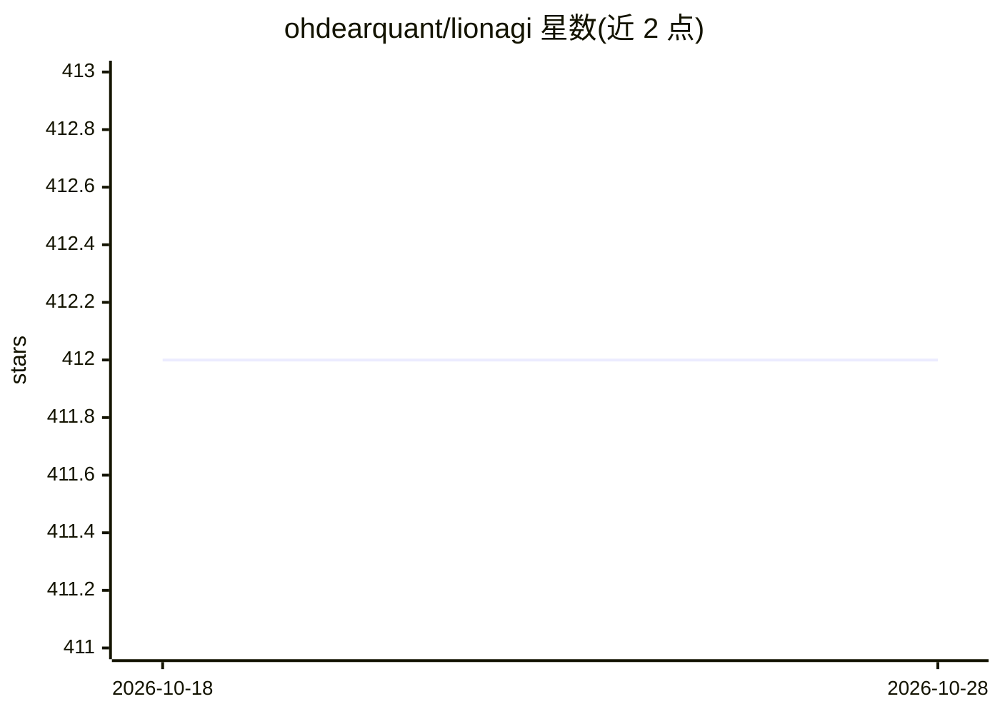

# ohdearquant/lionagi

⭐ 412 · Python · Apache-2.0 · 推送 2026-10-27 · [GitHub](https://github.com/ohdearquant/lionagi) · [官网](https://khive.ai) · 组织维护

**Python 多智能体编排框架：构建、运行与治理 agent 工作流**

lionagi 是一个多智能体编排框架，提供 Python API 与 `li` CLI 两种入口：可运行单 agent、并行 fan-out 和由编排器规划专家 worker 的 DAG 流程。状态为类型化、可检查的消息集合，持久化于 ~/.lionagi/runs/ 并可恢复；内置工具级权限策略、防护钩子与 git-worktree 沙箱等治理机制。CLI 模型别名（claude、codex 等）以子进程方式调用各厂商 CLI，API 端点支持 OpenAI/Anthropic/Gemini/Ollama 等。附带 Lion Studio 本地 Web UI 与 Claude Code 插件市场。自 2023 年持续开发，正在向 lion1 运行时迁移（向后兼容）。

## 筛选速览

| 维度 | 判定 | 备注 |
|---|---|---|
| AI 角色 | `ai-ecosystem` | LLM/agent 周边工具 |
| 许可风险 | `permissive` | Apache-2.0 |
| 部署形态 | `library` | 以包/库形式分发 |
| 模型依赖 | local-ok | 支持本地模型 |
| 硬件要求 | — | 无带数字的原话,不猜 |
| 安装摩擦 | `low` | 无编译、无系统依赖或容器化 |
| 成熟度 | — | 结构信号不足 |

## 能力要点

- 类型化可检查状态，运行持久化于 ~/.lionagi/runs/ 且可恢复
- CLI 别名以子进程调用 Claude Code/Codex 等 CLI，订阅登录即可用、无需 API key
- 工具调用权限策略、防护钩子与 git-worktree 沙箱等治理机制
- 内置 Lion Studio Web UI，支持 --docker 自包含部署

## 适用场景

- 用 Python 或终端构建单 agent、并行与 DAG 多智能体工作流
- 把订阅制 CLI agent 与 API 模型组合进同一编排流程
- 在权限门控与审计下运行可恢复的长期 agent 任务

## 场景标签

`多智能体` `Agent 框架` · 领域:Agent 开发

## 证据(README 行号)

> L8: **lionagi is a governed multi-agent orchestration framework.** Build agent
> L10: the terminal with the `li` CLI: single agents, parallel fan-outs, and DAG
> L64: - **You own the loop.** Branches, sessions, and flows are ordinary Python

## 星数曲线

2026-10-18 412 → 2026-10-28 412（+0）

---
*卡片 v1 · prompt 1.4 · 生成 2026-10-21 · 置信度 mid · 依据 README sha `51c8e0976ac3` · [字段定义](../../DATASET.md)*
