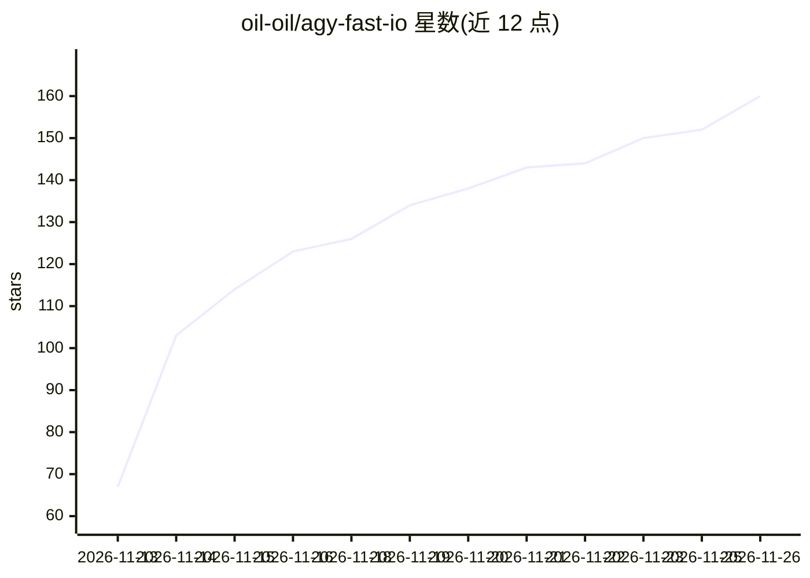

# oil-oil/agy-fast-io

⭐ 160 · MIT · 推送 2026-11-25 · [GitHub](https://github.com/oil-oil/agy-fast-io) · [官网](https://www.oiloil.org) · 个人维护 · 中文 README

**非官方 Antigravity 规则插件：减少 Agent 回合与云端审查等待**

仅包含一份不到 70 行 AGENTS.md 规则文件的 Antigravity 插件，无工具、Hook 和 MCP。规则改变 Agent 的干活习惯：先 grep 定位再一轮并行读完、只用免云端审查的白名单命令、合并需审查的命令、回答控制在 1500 字内。作者在一个 2000 多 Swift 文件的项目上对照测试，报告任务合计快近一半、模型回合约减半。局限包括规则非强制、改文件的审查省不掉、仅在一个 Swift 项目测试过、规则用中文写成。需 Antigravity 桌面版或 agy 命令行安装。

## 筛选速览

| 维度 | 判定 | 备注 |
|---|---|---|
| AI 角色 | `ai-ecosystem` | LLM/agent 周边工具 |
| 许可风险 | `permissive` | MIT |
| 部署形态 | `None` |  |
| 模型依赖 | — | README 未给出锁定关系 |
| 硬件要求 | — | 无带数字的原话,不猜 |
| 安装摩擦 | `low` | 无编译、无系统依赖或容器化 |
| 成熟度 | — | 结构信号不足 |

## 能力要点

- 单文件规则插件，无工具/Hook/MCP，完整规则不到 70 行
- 规则引导先定位再一轮读完、用白名单命令检索、合并待审命令
- 作者实测：4 类代码任务提速四分之一到一半，模型回合约减半
- 通过 agy plugin install 或复制目录安装，桌面版无需重启

## 适用场景

- Antigravity 用户减少 Agent 执行任务的回合数和等待时间
- 降低桌面版工具调用触发云端审查的比例
- 让 Agent 输出更简洁的代码分析回答

## 场景标签

`提示工程` · 领域:Agent 开发

## 证据(README 行号)

> L3: fast-io 是一个 Antigravity 插件，里面只有一份规则（`plugin/rules/AGENTS.md`），没有工具、Hook，也没有 MCP。它改的是 Agent 干活的习惯：怎么找代码、一次读多少、命令怎么写、回
> L48: 另外还有几条小规则：小改动用 `edit_file`，同一文件里相邻的几处合成一次改；小任务不写计划文档。完整规则不到 70 行，可以直接看 `AGENTS.md`。

## 星数曲线

2026-11-13 67 → 2026-11-26 160（+93）

---
*卡片 v1 · prompt 1.4 · 生成 2026-11-17 · 置信度 high · 依据 README sha `506127f9eb99` · [字段定义](../../DATASET.md)*
