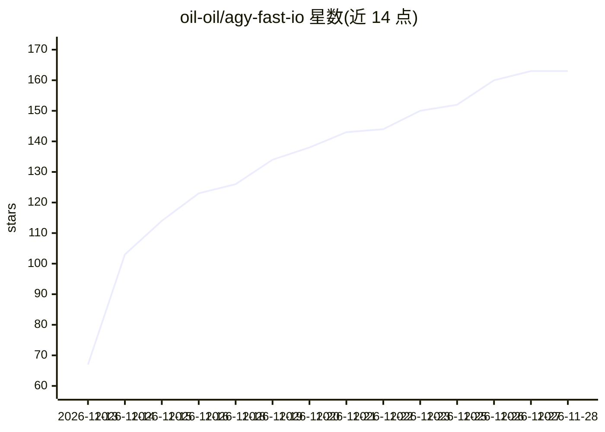

# oil-oil/agy-fast-io

⭐ 163 · MIT · 推送 2026-11-25 · [GitHub](https://github.com/oil-oil/agy-fast-io) · [官网](https://www.oiloil.org) · 个人维护 · 中文 README

**给 Antigravity Agent 减少回合与云端审查等待的规则插件**

非官方的 Antigravity 插件，内容仅是一份约 70 行的 AGENTS.md 规则文件，无工具、Hook 与 MCP。规则从四方面改变 Agent 工作习惯：先定位后一轮并行读完文件、检索只用白名单免审命令、必审命令合并为一次执行、回答先给结论并控制篇幅。作者在一个 2,000 多个 Swift 文件的项目上做对照测试，报告任务用时与模型回合约减半、送审工具调用比例下降；同时声明规则非强制、改文件审查无法省去、测试范围有限等局限。

## 筛选速览

| 维度 | 判定 | 备注 |
|---|---|---|
| AI 角色 | `ai-ecosystem` | LLM/agent 周边工具 |
| 许可风险 | `permissive` | MIT |
| 部署形态 | `None` |  |
| 模型依赖 | — | README 未给出锁定关系 |
| 硬件要求 | — | 无带数字的原话,不猜 |
| 安装摩擦 | `low` | 无编译、无系统依赖或容器化 |
| 成熟度 | — | 结构信号不足 |

## 能力要点

- 仅一份规则文件（AGENTS.md），不含工具、Hook 与 MCP
- 检索改用 grep/git ls-files 等桌面版白名单免审命令
- 必审命令用 && 合并执行，减少审查次数与等待回合
- 提供对照测试数据：用时与回合约减半，并声明波动与局限

## 适用场景

- 在 Antigravity 桌面版跑大型项目的代码检索与多文件改动任务时减少等待
- 减少工具调用触发云端审查的次数
- 控制 Agent 最终回答篇幅、节省长回答耗时

## 场景标签

`提示工程` `编码 Agent` · 领域:Agent 开发

## 证据(README 行号)

> L3: fast-io 是一个 Antigravity 插件，里面只有一份规则（`plugin/rules/AGENTS.md`），没有工具、Hook，也没有 MCP。它改的是 Agent 干活的习惯：怎么找代码、一次读多少、命令怎么写、回
> L50: ## 安装

## 星数曲线

2026-11-13 67 → 2026-11-28 163（+96）

---
*卡片 v1 · prompt 1.4 · 生成 2026-11-27 · 置信度 high · 依据 README sha `031735083bfe` · [字段定义](../../DATASET.md)*
