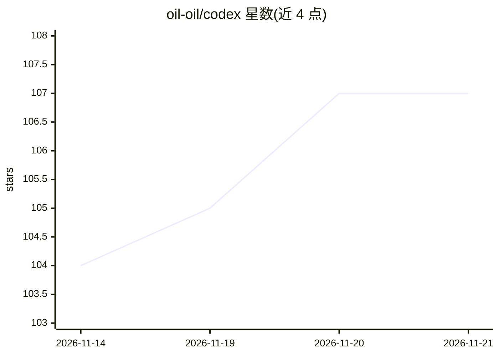

# oil-oil/codex

⭐ 107 · PowerShell · 推送 2026-11-18 · [GitHub](https://github.com/oil-oil/codex) · 个人维护 · 中文 README

**让其他 Agent 把 Codex CLI 作为可持续会话的编码子 Agent 的 Skill**

面向支持 Skill 的 Agent 框架的包装脚本：通过 Bash/PowerShell 脚本派发 Codex CLI 会话，把代码探索、实现、修复、评审与测试委托给持久化编码 Agent，并用 session_id 续接同一任务继续处理。每次运行建立独立产物目录，输出 Markdown 结果、结构化状态与原始 JSONL 事件；模型与 Provider 由 Codex CLI 配置决定。默认以最高权限运行并跳过 Codex 沙箱与审批，可用 --read-only/--sandbox 限制。需要已安装并登录 Codex CLI，macOS/Linux 需 jq，通过 npx skills 安装。

## 筛选速览

| 维度 | 判定 | 备注 |
|---|---|---|
| AI 角色 | `ai-ecosystem` | LLM/agent 周边工具 |
| 许可风险 | `none` | — |
| 部署形态 | `library` | 以包/库形式分发 |
| 模型依赖 | — | README 未给出锁定关系 |
| 硬件要求 | — | 无带数字的原话,不猜 |
| 安装摩擦 | `low` | 无编译、无系统依赖或容器化 |
| 成熟度 | — | 结构信号不足 |

## 能力要点

- 包装脚本派发 Codex CLI 会话并支持 session_id 续接同一任务
- 每次运行输出独立产物目录：Markdown 结果、运行状态与 JSONL 事件
- 支持 --read-only、--sandbox、--output-schema、--image 等参数
- 提供 macOS/Linux 包装脚本的回归测试（tests/test_ask_codex.sh）

## 适用场景

- 让主 Agent 把边界清楚的编码或修复任务委托给 Codex 子 Agent
- 在同一会话中继续之前的任务而不重复传递背景
- 让 Agent 引用具体文件和行号进行代码评审并整理测试结果

## 场景标签

`编码 Agent` `代码审查` · 领域:编码与开发

## 证据(README 行号)

> L1: codex：让其他 Agent 把 Codex CLI 作为可持续对话的编码子 Agent
> L70:  调用方 Agent 通过包装脚本派发 Codex CLI 会话、读取运行产物并使用 session_id 继续任务
> L105: 包装脚本始终使用 Codex CLI 当前生效的默认配置，不会根据其他目录中的配置自动切换运行环境。模型和 Provider 由 Codex CLI 配置决定。常规调用不需要指定模型、Provider 或思考强度；默认思考强度为

## 星数曲线

2026-11-14 104 → 2026-11-21 107（+3）

---
*卡片 v1 · prompt 1.4 · 生成 2026-11-17 · 置信度 high · 依据 README sha `0edaad594b37` · [字段定义](../../DATASET.md)*
