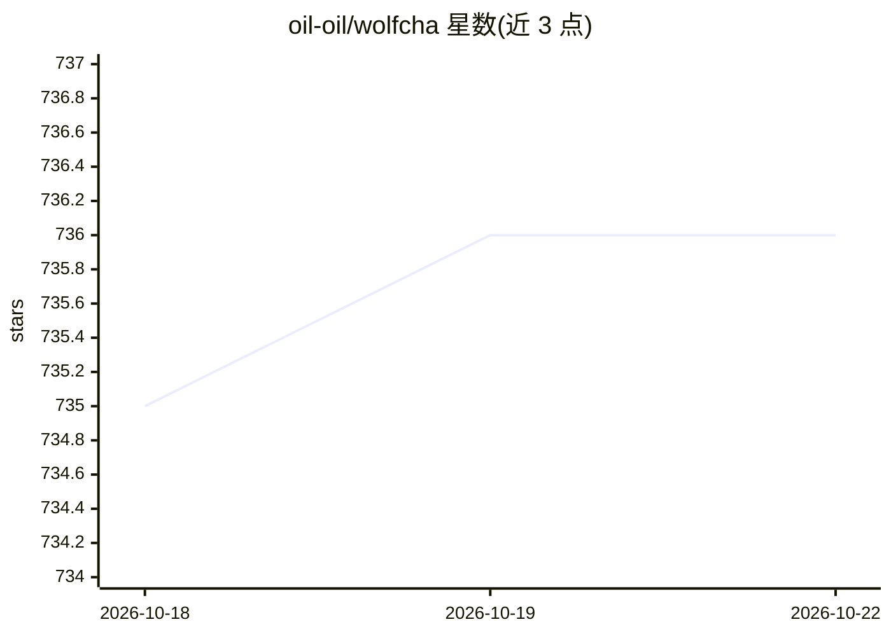

# oil-oil/wolfcha

⭐ 737 · TypeScript · Apache-2.0 · 推送 2026-10-17 · [GitHub](https://github.com/oil-oil/wolfcha) · [官网](https://wolf-cha.com) · 个人维护 · 中文 README

**单人 AI 狼人杀：一人入座，LLM 扮演其余玩家**

基于 Next.js 的 AI 狼人杀（社会推理）游戏：玩家选择身份进入 8–12 人对局，其余座位由 LLM 玩家填充。每个 AI 具备稳定性格叠加隐藏身份，跟踪发言、投票、死亡与嫌疑变化，并按阵营目标指控、辩护、虚张声势或投票。对话实时生成，同一配置可产生不同对局；提供复古视觉、唇形同步动画、可选 AI 语音与观战模式。项目诞生于 Watcha × ModelScope 黑客松，本地运行需 Node.js 与 pnpm，API 配置通过 .env.local 指定（具体供应商文档在 .env.example）。

## 筛选速览

| 维度 | 判定 | 备注 |
|---|---|---|
| AI 角色 | `ai-native` | 本体是模型或模型工具 |
| 许可风险 | `permissive` | Apache-2.0 |
| 部署形态 | `library` | 以包/库形式分发 |
| 模型依赖 | — | README 未给出锁定关系 |
| 硬件要求 | — | 无带数字的原话,不猜 |
| 安装摩擦 | `low` | 无编译、无系统依赖或容器化 |
| 成熟度 | — | 结构信号不足 |

## 能力要点

- 8–12 人对局中由 LLM 玩家填充其余座位
- AI 玩家具备性格、身份阵营目标与对局记忆
- 对话实时生成，同一配置产生不同对局
- 复古视觉、唇形同步、可选 AI 语音与观战模式

## 适用场景

- 一个人凑齐整桌狼人杀对局
- 体验与多个不同性格的 AI 玩家进行推理博弈
- 观战 AI 之间进行狼人杀对局

## 场景标签

`多智能体` · 领域:Agent 开发

## 证据(README 行号)

> L5:  You take one seat. AI players fill the rest.
> L18: Wolfcha recreates the part of Werewolf that is hardest to schedule: a complete table of distinct players. Choose yo
> L31: You can play as **Villager, Werewolf, White Wolf King, Seer, Witch, Hunter, Guard, or Idiot**. Conversations are ge

## 星数曲线

2026-10-18 735 → 2026-10-22 736（+1）

---
*卡片 v1 · prompt 1.4 · 生成 2026-10-21 · 置信度 high · 依据 README sha `46daa86d7ac8` · [字段定义](../../DATASET.md)*
