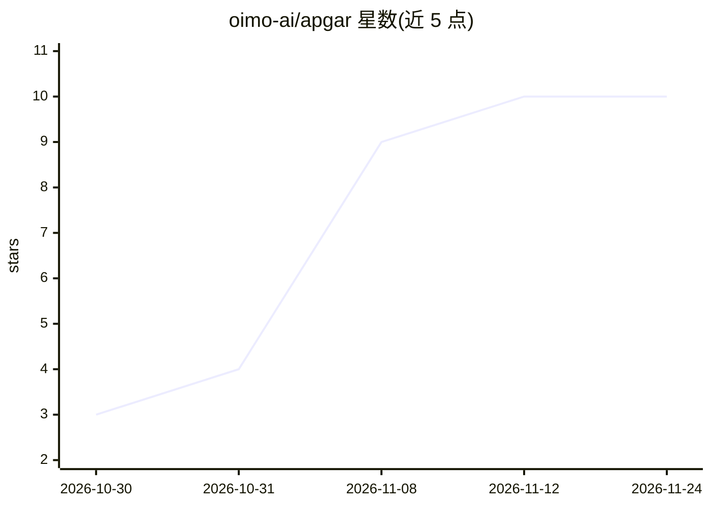

# oimo-ai/apgar

⭐ 11 · Python · Apache-2.0 · 推送 2026-11-11 · [GitHub](https://github.com/oimo-ai/apgar) · [官网](https://useapgar.dev) · 组织维护

**AI agent 发布健康监控：对比新版本与基线表现**

Apgar 监控每次 AI agent 发布后的最初运行时段，比较新版本相对前一版本的工具错误、重试与循环、工具调用次数、回答长度、成本与延迟等信号，输出每个版本一次的 Slack 消息或 webhook。数据来自已有的 trace（OTLP/OpenTelemetry 或从 Langfuse 拉取），按 release 属性标记部署，不使用 LLM judge，不需要数据集，不存储 prompt 或补全文本。通过 Docker Compose 或 Helm 部署，升级前需备份 ClickHouse。

## 筛选速览

| 维度 | 判定 | 备注 |
|---|---|---|
| AI 角色 | `ai-ecosystem` | LLM/agent 周边工具 |
| 许可风险 | `permissive` | Apache-2.0 |
| 部署形态 | `self-host` | docker 或自建部署 |
| 模型依赖 | — | README 未给出锁定关系 |
| 硬件要求 | — | 无带数字的原话,不猜 |
| 安装摩擦 | `low` | 无编译、无系统依赖或容器化 |
| 成熟度 | — | 结构信号不足 |

## 能力要点

- 基于已有 trace 的全流量发布健康对比，无需 LLM judge 与数据集
- 支持 OpenTelemetry 发送 trace 或从 Langfuse 拉取
- 每版本输出一条 Slack/webhook 报告，指出变化的信号与集中位置
- 提供 Docker Compose 与 Kubernetes Helm 两种部署方式

## 适用场景

- 发布新版本 agent 后自动检测工具错误率是否回归
- 用 release 标签对比各版本的成本与延迟变化
- 自托管部署监控生产环境 agent 行为

## 场景标签

`LLM 可观测性` `模型评测` · 领域:评测与运维

## 证据(README 行号)

> L3:  Release health for AI agents.
> L12: Agents don't crash when they get worse. Apgar watches the first hours of every release and tells you whether your a

## 星数曲线

2026-10-30 3 → 2026-11-24 10（+7）

---
*卡片 v1 · prompt 1.4 · 生成 2026-11-19 · 置信度 mid · 依据 README sha `9816d4041cc7` · [字段定义](../../DATASET.md)*
