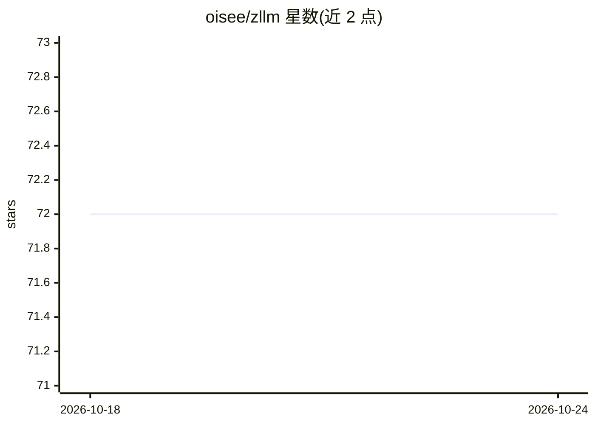

# oisee/zllm

⭐ 72 · ABAP · MIT · 推送 2026-01-01 · [GitHub](https://github.com/oisee/zllm) · 个人维护

**纯 ABAP 实现的企业 LLM 编排框架，供 SAP 开发者构建 AI 工作流**

ZLLM 是运行于 SAP/ABAP 系统内的 LLM 编排框架，功能包括顺序/并行/嵌套的链式流程、懒执行非阻塞操作、深度结构导航的模板引擎、默认开启的缓存与负载均衡、以及无需 API 调用的 token 预测（PREDICTOKEN，README 给出 R² 0.997）。通过 .env 配置接入 OpenAI 兼容 API（Ollama、LM Studio、OpenAI）与 Azure OpenAI。零外部依赖，提供 onboarding 程序、REPL 与演示程序，API key 以对称编码存储。

## 筛选速览

| 维度 | 判定 | 备注 |
|---|---|---|
| AI 角色 | `ai-ecosystem` | LLM/agent 周边工具 |
| 许可风险 | `permissive` | MIT |
| 部署形态 | `None` |  |
| 模型依赖 | local-ok | 支持本地模型 |
| 硬件要求 | — | 无带数字的原话,不猜 |
| 安装摩擦 | `low` | 无编译、无系统依赖或容器化 |
| 成熟度 | — | 结构信号不足 |

## 能力要点

- 链式/并行/嵌套流程编排，结果自动传递
- 纯 ABAP 实现，零外部依赖，运行于 SAP 系统内
- PREDICTOKEN 无需 API 调用即可预测 token 用量
- 缓存默认开启，支持按复杂度路由多模型的负载均衡

## 适用场景

- 在 SAP ERP/S/4 环境内构建多步 LLM 工作流
- ABAP 结构化数据与模板结合生成动态提示词
- 通过 .env 切换 Ollama、LM Studio、OpenAI、Azure 等后端

## 场景标签

`工作流自动化` `Agent 框架` · 领域:Agent 开发

## 证据(README 行号)

> L3: ZLLM is a sophisticated "LangChain-lite" framework that brings the power of Large Language Model (LLM) orchestration
> L7: Like LangChain, ZLLM provides:
> L8: - **Chain Composition**: Build complex workflows by chaining multiple LLM calls

## 星数曲线

2026-10-18 72 → 2026-10-24 72（+0）

---
*卡片 v1 · prompt 1.4 · 生成 2026-10-24 · 置信度 high · 依据 README sha `9121fabb3e14` · [字段定义](../../DATASET.md)*
