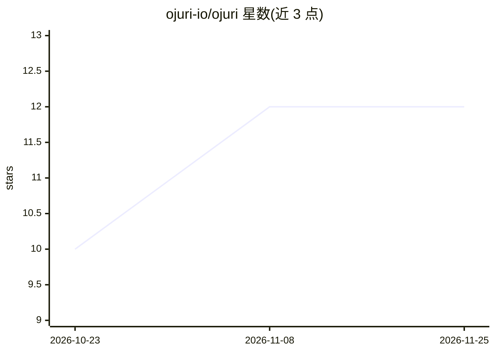

# ojuri-io/ojuri

⭐ 12 · TypeScript · MIT · 推送 2026-09-29 · [GitHub](https://github.com/ojuri-io/ojuri) · [官网](https://ojuri.io) · 个人维护

**自托管多智能体欺诈检测：实时交易判定与 LLM 调查**

Ojuri 是可完全自托管的开源支付欺诈检测系统：调用 /v1/predict 即时返回接受/复核/拒绝决策及理由码。四个服务分工——RDA 毫秒级响应、PAA 构建支付行为图谱、MLA 监测模型漂移并重训、FIA 用本地运行的语言模型对被拒交易生成调查报告。提供 Sentinel 仪表盘（复核队列、规则编辑器、模型注册、审计日志），附 12.8 万笔交易的欺诈模拟用于效果复现。MIT 许可，无 SaaS 账户与按调用计费。

## 筛选速览

| 维度 | 判定 | 备注 |
|---|---|---|
| AI 角色 | `ai-native` | 本体是模型或模型工具 |
| 许可风险 | `permissive` | MIT |
| 部署形态 | `self-host` | docker 或自建部署 |
| 模型依赖 | — | README 未给出锁定关系 |
| 硬件要求 | — | 无带数字的原话,不猜 |
| 安装摩擦 | `low` | 无编译、无系统依赖或容器化 |
| 成熟度 | — | 结构信号不足 |

## 能力要点

- 毫秒级 /v1/predict 返回决策与理由码
- 基于 Kafka 的多服务架构，仅 RDA 在关键路径上
- MLA 漂移监测与自动重训，新模型经校验后晋升
- FIA 在本地运行 LLM 生成交易调查报告，可禁用改用规则报告

## 适用场景

- 支付系统接入实时欺诈决策 API
- 数据需留在自有基础设施以满足 GDPR/NDPR 等要求
- 欺诈分析师在仪表盘复核并让模型学习人工纠正
- 对被拒交易自动生成调查报告供分析

## 场景标签

`多智能体` · 领域:Agent 开发

## 证据(README 行号)

> L8: Ojuri decides whether a payment is fraud, in the moment it happens. Send
> L31: Four services split the work. **RDA** answers your API call in
> L202: blocks is handed to FIA, which runs a language model on your own hardware

## 星数曲线

2026-10-23 10 → 2026-11-25 12（+2）

---
*卡片 v1 · prompt 1.4 · 生成 2026-11-18 · 置信度 high · 依据 README sha `bc9340e9bb96` · [字段定义](../../DATASET.md)*
