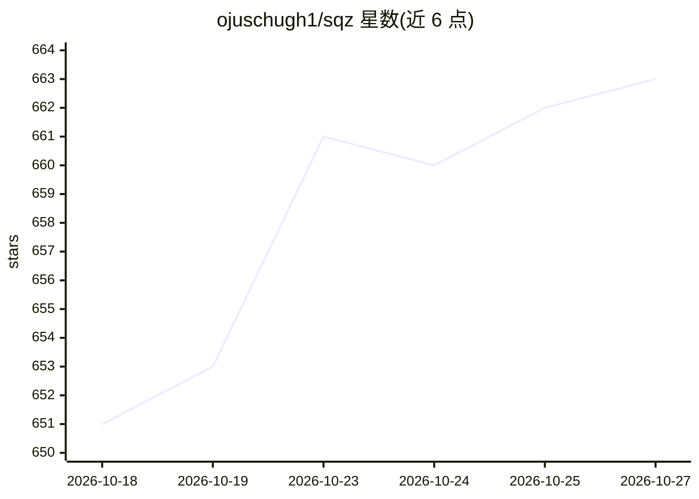

# ojuschugh1/sqz

⭐ 663 · Rust · Apache-2.0 · 推送 2026-10-22 · [GitHub](https://github.com/ojuschugh1/sqz) · [官网](https://ojuschugh1.github.io/sqz/) · 个人维护 · 中文 README

**压缩 AI 编程 agent 工具输出的上下文压缩工具**

面向 AI 编程 agent（Claude Code、Cursor、Codex、Kiro、Zed 等 MCP 客户端）的上下文压缩与会话去重工具：在工具输出进入模型前按命令类型压缩（git、cargo、pytest、kubectl 等），模型已见过的内容以约 13 token 的引用替代，源码、堆栈、凭据行原样透传。单个 Rust 二进制，确定性运行，无 LLM 调用，可离线工作，结果可用 sqz expand 逐字节还原。通过 sqz init 写入各客户端 hooks 与 MCP 配置，支持 cargo/brew/npm/pipx/预编译二进制安装。

## 筛选速览

| 维度 | 判定 | 备注 |
|---|---|---|
| AI 角色 | `ai-ecosystem` | LLM/agent 周边工具 |
| 许可风险 | `permissive` | Apache-2.0 |
| 部署形态 | `desktop` | 安装包/桌面程序 |
| 模型依赖 | — | README 未给出锁定关系 |
| 硬件要求 | — | 无带数字的原话,不猜 |
| 安装摩擦 | `high` | 编译与系统依赖俱全 |
| 成熟度 | — | 结构信号不足 |

## 能力要点

- 按命令类型的输出压缩，模型已有的重复内容替换为 13-token 引用
- 单 Rust 二进制、确定性、零 LLM 调用、可离线运行
- sqz expand 可逐字节还原压缩结果（凭据/堆栈/迁移永不缓存）
- sqz init 自动为 8 种 agent 客户端写入 hooks 与 MCP 配置

## 适用场景

- 降低 AI 编程 agent 的 token 消耗与上下文占用
- 重放历史会话估算压缩收益（sqz discover --replay）
- 通过 MCP 代理压缩 MCP server 的长输出

## 场景标签

 · 领域:开发者工具/LLM 上下文管理

## 证据(README 行号)

> L10:  Pre-injection context compression and session deduplication for AI coding agents
> L43: sqz compresses tool output before it enters the context. Per-command formatters keep what an agent acts on (the fai
> L61: Single Rust binary, deterministic, no LLM calls, works offline. Every compressed result can be recovered byte-exact
> L266: On transparent clients (Claude Code, Gemini CLI, Copilot CLI, OpenCode) sqz installs a hook that rewrites shell co

## 星数曲线

2026-10-18 651 → 2026-10-27 663（+12）

---
*卡片 v1 · prompt 1.4 · 生成 2026-10-22 · 置信度 high · 依据 README sha `64662444fc02` · [字段定义](../../DATASET.md)*
