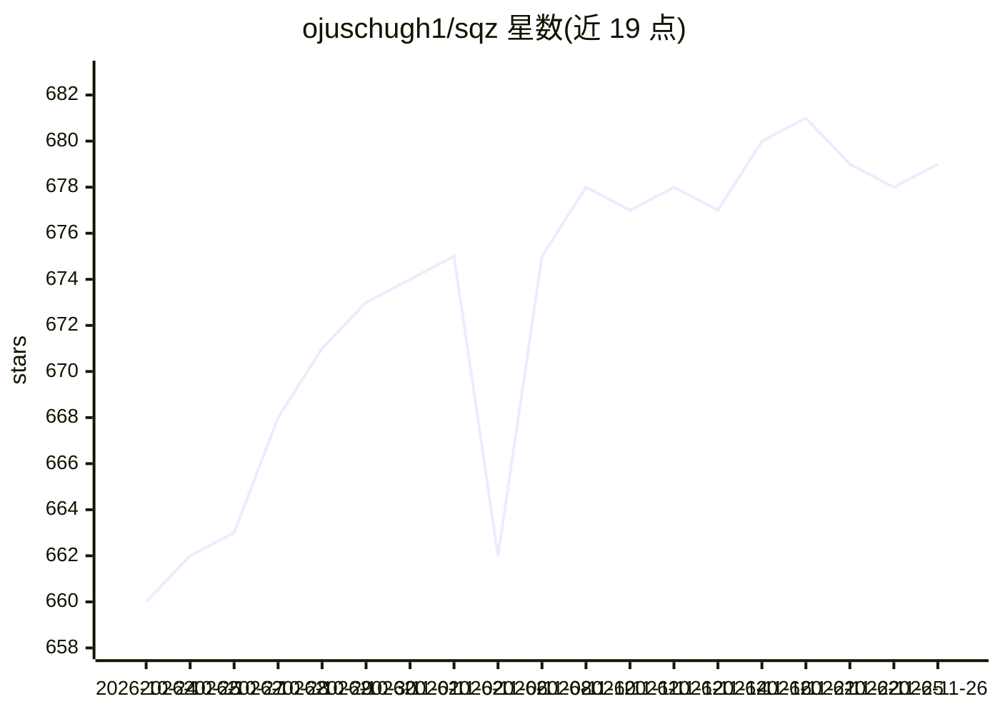

# ojuschugh1/sqz

⭐ 679 · Rust · Apache-2.0 · 推送 2026-11-12 · [GitHub](https://github.com/ojuschugh1/sqz) · [官网](https://ojuschugh1.github.io/sqz/) · 个人维护 · 中文 README

**为 AI 编码 agent 压缩工具输出的 Rust CLI/MCP 代理**

在工具输出进入上下文之前进行压缩：按命令类型保留 agent 可操作的关键信息（失败测试、断言、file:line），已存在于上下文中的内容以短引用代替；源代码、堆栈跟踪、迁移和凭证行原样通过。单 Rust 二进制、确定性、无 LLM 调用、可离线运行，sqz expand 可字节精确恢复。通过 sqz init 为 Claude Code、Cursor、Codex、Kiro 等 MCP 客户端安装 hooks 与 MCP server，提供 cargo/brew/npm/pipx 及预编译二进制安装方式。

## 筛选速览

| 维度 | 判定 | 备注 |
|---|---|---|
| AI 角色 | `ai-ecosystem` | LLM/agent 周边工具 |
| 许可风险 | `permissive` | Apache-2.0 |
| 部署形态 | `desktop` | 安装包/桌面程序 |
| 模型依赖 | — | README 未给出锁定关系 |
| 硬件要求 | — | 无带数字的原话,不猜 |
| 安装摩擦 | `high` | 编译与系统依赖俱全 |
| 成熟度 | — | 结构信号不足 |

## 能力要点

- 会话级去重：已有内容以 13-token 引用替代，附带 sqz expand 字节精确恢复
- 每命令格式化压缩（日志、JSON、git diff），源码与堆栈跟踪 0% 修改
- sqz discover --replay 基于本地转录做压缩收益的事前估计
- sqz doctor 检查 hook/MCP/客户端路由链并自动修复

## 适用场景

- 为 Claude Code 等 agent 降低长会话的 token 消耗
- 在离线环境对 agent 工具输出做确定性压缩
- 接入 MCP 客户端前先评估可节省的 token 量

## 场景标签

 · 领域:开发者工具/LLM 基础设施

## 证据(README 行号)

> L10:  Pre-injection context compression and session deduplication for AI coding agents
> L268: On transparent clients (Claude Code, Gemini CLI, Copilot CLI, OpenCode) sqz installs a hook that rewrites shell co

## 星数曲线

2026-10-24 660 → 2026-11-26 679（+19）

---
*卡片 v1 · prompt 1.4 · 生成 2026-11-24 · 置信度 high · 依据 README sha `2297bf484708` · [字段定义](../../DATASET.md)*
