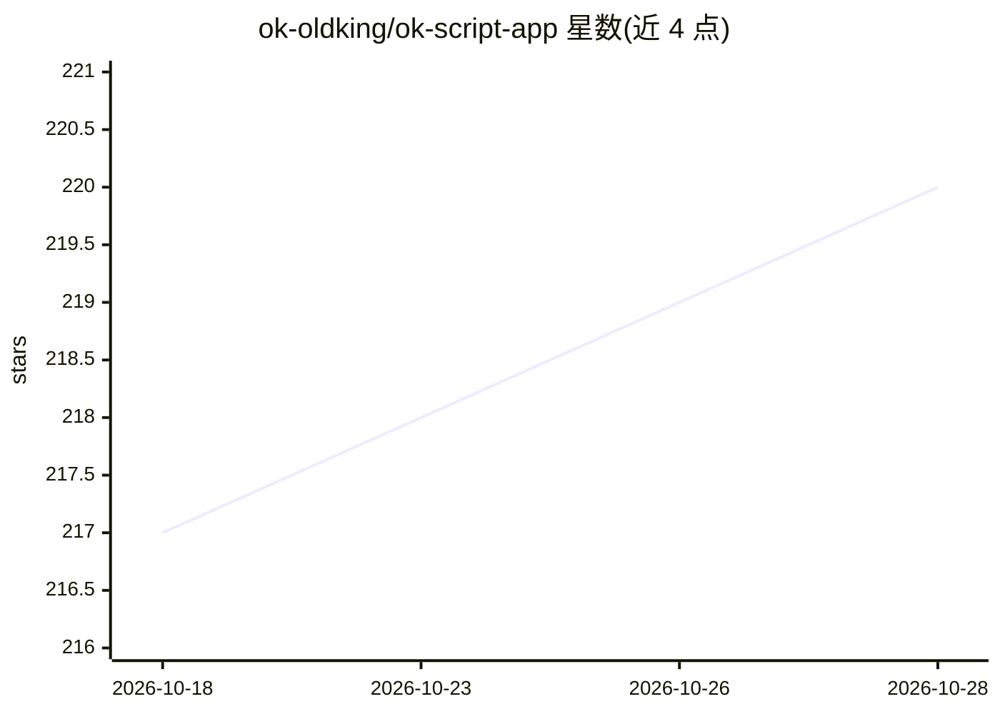

# ok-oldking/ok-script-app

⭐ 220 · Python · 推送 2026-08-16 · [GitHub](https://github.com/ok-oldking/ok-script-app) · 个人维护 · 中文 README

**基于 ok-script 的 Python 游戏自动化应用起步模板**

基于 ok-script 的 Python 项目模板，面向为 Windows 原生游戏、Android 模拟器和浏览器游戏开发带 GUI 的自动化应用的开发者。仓库提供任务示例、OCR、模板匹配、配置控件、测试、i18n、EXE 打包与更新发布配置，定位是起步工程和功能演示，不是具体游戏的成品脚本。支持 Qt 与 Web 两种依赖 profile，文档以 MkDocs 源文件形式提供并可通过 GitHub Pages 发布。

## 筛选速览

| 维度 | 判定 | 备注 |
|---|---|---|
| AI 角色 | `ai-enhanced` | 去掉 AI 部分产品仍成立 |
| 许可风险 | `none` | — |
| 部署形态 | `library` | 以包/库形式分发 |
| 模型依赖 | — | README 未给出锁定关系 |
| 硬件要求 | — | 无带数字的原话,不猜 |
| 安装摩擦 | `low` | 无编译、无系统依赖或容器化 |
| 成熟度 | — | 结构信号不足 |

## 能力要点

- 覆盖 Windows 原生游戏、Android 模拟器、浏览器游戏三类运行目标
- 内置 OCR 与模板匹配能力及任务示例
- 提供配置控件、测试、i18n、EXE 打包与更新发布配置
- Qt / Web 双依赖 profile，文档以 MkDocs 组织

## 适用场景

- 为游戏自动化脚本搭建带 GUI 的工程起点
- 复用 OCR 与模板匹配做游戏画面识别
- 打包并发布自己的自动化 EXE 应用

## 场景标签

`GUI 自动化` `OCR` · 领域:效率与自动化

## 证据(README 行号)

> L5: ok-script-app 是一个基于 ok-script 的 Python 自动化项目模板，支持为 Windows 原生游戏、Android 模拟器和浏览器游戏创建带 GUI 的自动化应用。
> L7: 这个仓库提供任务示例、OCR、模板匹配、配置控件、测试、i18n、EXE 打包和更新发布配置。它是起步工程和功能演示，不是某个具体游戏的自动化成品。

## 星数曲线

2026-10-18 217 → 2026-10-28 220（+3）

---
*卡片 v1 · prompt 1.4 · 生成 2026-10-22 · 置信度 mid · 依据 README sha `73ae93d17f09` · [字段定义](../../DATASET.md)*
