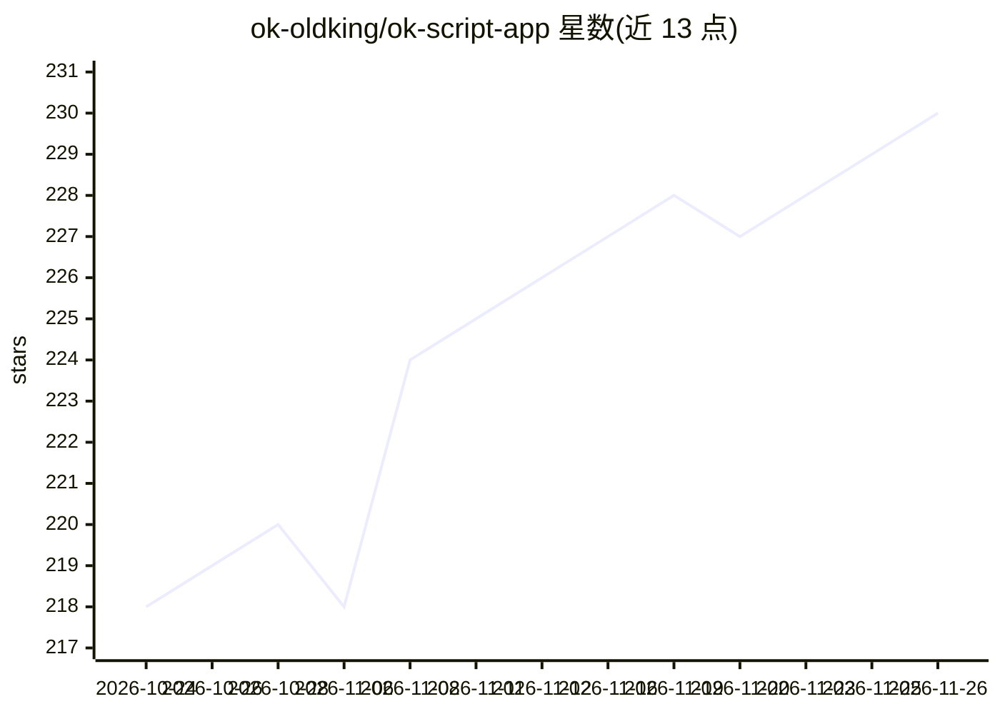

# ok-oldking/ok-script-app

⭐ 230 · Python · 推送 2026-11-03 · [GitHub](https://github.com/ok-oldking/ok-script-app) · 个人维护 · 中文 README

**基于 ok-script 的 Windows/模拟器游戏自动化项目模板**

一个 Python 自动化起步工程模板，用于为 Windows 原生游戏、Android 模拟器和浏览器游戏创建带 GUI 的自动化应用。仓库提供任务示例、OCR、模板匹配、配置控件、测试、i18n、EXE 打包和更新发布配置，文档整理为 MkDocs 网站源文件并可通过 GitHub Pages 发布。README 明确说明它是起步工程和功能演示，不是某个具体游戏的自动化成品；依赖锁定在 ok-script 3.0.0b3，ok-script 3 已移除 Web 界面。

## 筛选速览

| 维度 | 判定 | 备注 |
|---|---|---|
| AI 角色 | `ai-enhanced` | 去掉 AI 部分产品仍成立 |
| 许可风险 | `none` | — |
| 部署形态 | `library` | 以包/库形式分发 |
| 模型依赖 | — | README 未给出锁定关系 |
| 硬件要求 | — | 无带数字的原话,不猜 |
| 安装摩擦 | `low` | 无编译、无系统依赖或容器化 |
| 成熟度 | — | 结构信号不足 |

## 能力要点

- 基于 ok-script 生成带 GUI 的自动化应用模板
- 内置 OCR 与模板匹配能力
- 提供 EXE 打包与更新发布配置
- MkDocs 文档网站源文件，可发布到 GitHub Pages

## 适用场景

- 作为新自动化脚本的起步工程模板
- 为 Windows 原生游戏或模拟器游戏制作带界面的自动化工具
- 学习 ok-script 的任务开发与打包流程

## 场景标签

`GUI 自动化` · 领域:效率与自动化

## 证据(README 行号)

> L5: ok-script-app 是一个基于 ok-script 的 Python 自动化项目模板，支持为 Windows 原生游戏、Android 模拟器和浏览器游戏创建带 GUI 的自动化应用。
> L7: 这个仓库提供任务示例、OCR、模板匹配、配置控件、测试、i18n、EXE 打包和更新发布配置。它是起步工程和功能演示，不是某个具体游戏的自动化成品。

## 星数曲线

2026-10-24 218 → 2026-11-26 230（+12）

---
*卡片 v1 · prompt 1.4 · 生成 2026-11-25 · 置信度 high · 依据 README sha `32f1632cd2bd` · [字段定义](../../DATASET.md)*
