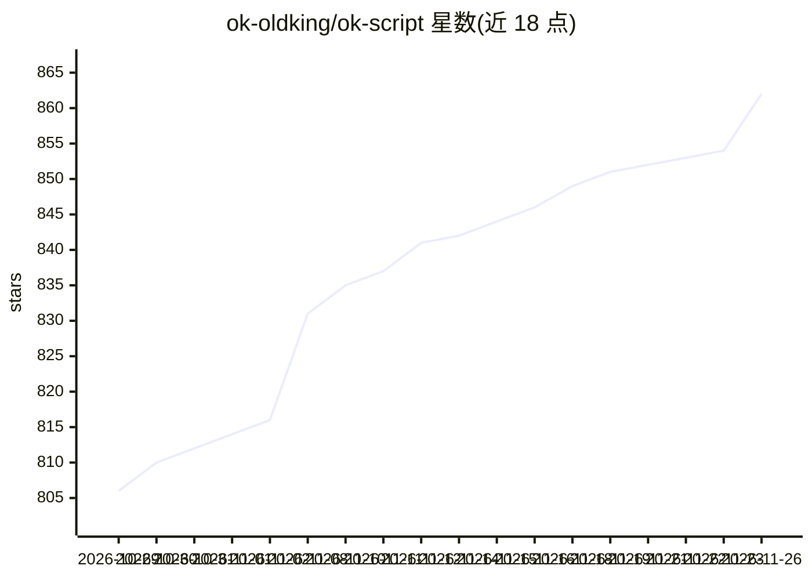

# ok-oldking/ok-script

⭐ 862 · Python · NOASSERTION · 推送 2026-11-25 · [GitHub](https://github.com/ok-oldking/ok-script) · [官网](https://ok-script.com/) · 个人维护 · 中文 README

**给编程代理用的 Windows/安卓自动化框架：MCP 驱动生成任务**

面向 Codex、Claude Code 等 MCP 编程代理的自动化框架：代理通过 MCP 服务截图观察 Windows 应用、游戏或安卓设备，编写并调试 Python 任务，最终连同桌面 GUI 打包成可分发的 Windows 安装包。生成的程序在本地独立完成截图、识别与输入，运行时不依赖代理与模型调用。提供模板匹配、OCR、YOLO 等视觉方案、COCO 标注管理、热重载与逐次运行日志。基于 Python 3.11+，Apache 2.0 + Commons Clause 许可。

## 筛选速览

| 维度 | 判定 | 备注 |
|---|---|---|
| AI 角色 | `ai-ecosystem` | LLM/agent 周边工具 |
| 许可风险 | `none` | NOASSERTION |
| 部署形态 | `desktop` | 安装包/桌面程序 |
| 模型依赖 | — | README 未给出锁定关系 |
| 硬件要求 | — | 无带数字的原话,不猜 |
| 安装摩擦 | `low` | 无编译、无系统依赖或容器化 |
| 成熟度 | — | 结构信号不足 |

## 能力要点

- MCP 服务提供截图、任务执行、热重载与运行日志工具
- 同一套任务代码支持 Windows 客户端、安卓模拟器与 ADB 设备
- 生成程序本地运行，运行时零 token、无需代理连接
- 通过 PyAppify 打包为 Windows 安装包

## 适用场景

- 让编程代理代写游戏或桌面应用的自动化任务脚本
- 把调试完成的自动化任务打包成独立 Windows 程序分发
- 基于模板匹配和 OCR 搭建界面自动化流程

## 场景标签

`GUI 自动化` · 领域:效率与自动化

## 证据(README 行号)

> L5: **Vibe Coding 自动化框架**
> L9: 说出你想自动化的事。代理通过 MCP 观察 Windows 应用、游戏或安卓设备，编写 Python 任务，在真实目标上运行并修复失败。ok-script 把完成的任务连同桌面 GUI 打包成可分发的 Windows 安装包。打包后
> L64: - 面向编程代理的 MCP 服务：内置技能、实时截图、任务执行、热重载和逐次运行日志

## 星数曲线

2026-10-29 806 → 2026-11-26 862（+56）

---
*卡片 v1 · prompt 1.4 · 生成 2026-11-26 · 置信度 mid · 依据 README sha `33c47bd90909` · [字段定义](../../DATASET.md)*
