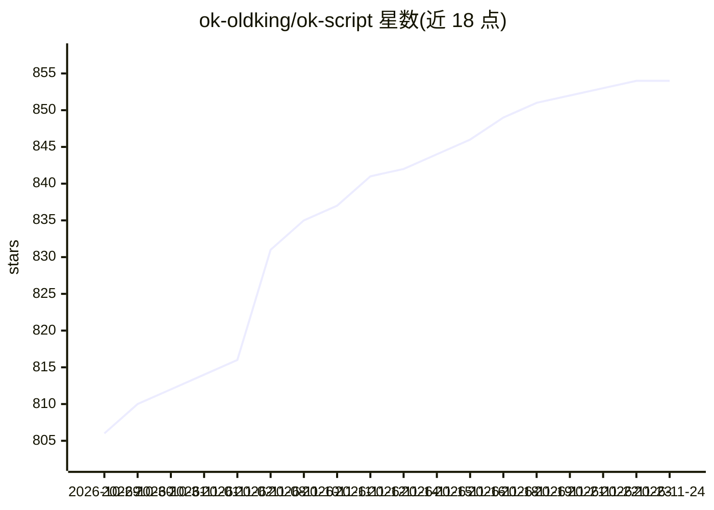

# ok-oldking/ok-script

⭐ 854 · Python · NOASSERTION · 推送 2026-11-22 · [GitHub](https://github.com/ok-oldking/ok-script) · [官网](https://ok-script.com/) · 个人维护 · 中文 README

**让编程代理通过 MCP 生成 Windows/安卓自动化任务的 Python 框架**

面向 Codex、Claude Code 等 MCP 编程代理的 Python 自动化框架：代理通过 MCP 服务对 Windows 应用、游戏或安卓设备截图观察，编写并运行 Python 任务，借助热重载与逐次运行日志迭代修复。框架提供模板匹配、OCR、YOLO 等视觉方案、基于 COCO 的模板管理与后台输入，完成的任务可脱离代理独立运行，并用 PyAppify 打包为 Windows 安装包。支持 Python 3.11+，采用 Apache 2.0 + Commons Clause 许可。

## 筛选速览

| 维度 | 判定 | 备注 |
|---|---|---|
| AI 角色 | `ai-ecosystem` | LLM/agent 周边工具 |
| 许可风险 | `none` | NOASSERTION |
| 部署形态 | `desktop` | 安装包/桌面程序 |
| 模型依赖 | — | README 未给出锁定关系 |
| 硬件要求 | — | 无带数字的原话,不猜 |
| 安装摩擦 | `low` | 无编译、无系统依赖或容器化 |
| 成熟度 | — | 结构信号不足 |

## 能力要点

- MCP 服务提供 list_skills/screenshot/run_task/reload_tasks 等工具与逐次运行日志
- 支持 OCR、OpenCV 模板匹配及 YOLO 视觉方案，模板按分辨率自动缩放
- 生成任务 0 token 独立运行，可打包成 Windows 安装包
- 同一套任务代码覆盖 Windows 客户端、安卓模拟器与 ADB 设备

## 适用场景

- 用编程代理给 Windows 游戏或应用生成自动化任务
- 维护多个游戏自动化项目（如 okww、okef）并分享任务
- 把已完成的自动化任务打包分发给普通用户使用

## 场景标签

`GUI 自动化` · 领域:效率与自动化

## 证据(README 行号)

> L7: 在 Codex、Claude Code 或任何支持 MCP 的编程代理里许个愿，得到一个可部署的自动化程序。
> L53: 代理用自己的工具编辑文件、读取日志；MCP 让它直接操作正在运行的应用：
> L64: - 面向编程代理的 MCP 服务：内置技能、实时截图、任务执行、热重载和逐次运行日志

## 星数曲线

2026-10-29 806 → 2026-11-24 854（+48）

---
*卡片 v1 · prompt 1.4 · 生成 2026-11-24 · 置信度 mid · 依据 README sha `751b5d3636dc` · [字段定义](../../DATASET.md)*
