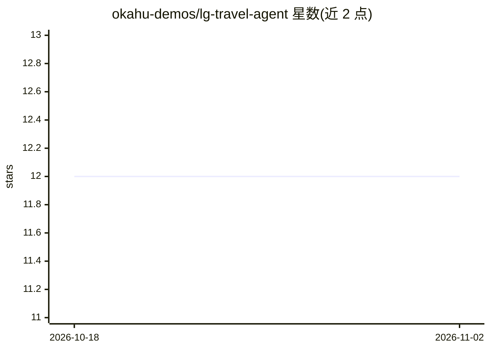

# okahu-demos/lg-travel-agent

⭐ 12 · Python · Apache-2.0 · 推送 2026-09-17 · [GitHub](https://github.com/okahu-demos/lg-travel-agent) · [官网](https://portal.okahu.co) · 组织维护

**LangGraph+OpenAI 构建的示例旅行 Agent，演示 GenAI 追踪调试**

Okahu 团队维护的演示型 Python 应用：基于 LangGraph 多 Agent 框架与 OpenAI GPT-4o 模型，通过模拟 MCP 天气工具实现机票与酒店预订。应用预置开源 Monocle 插桩生成追踪数据，可在 VS Code 或 Okahu 云端可视化，用于演示如何识别与修复 Agent 应用的路由、提示注入等问题。运行需 OpenAI API key，云端功能需注册 Okahu。提供 pytest 测试与云端评估流程。

## 筛选速览

| 维度 | 判定 | 备注 |
|---|---|---|
| AI 角色 | `ai-native` | 本体是模型或模型工具 |
| 许可风险 | `permissive` | Apache-2.0 |
| 部署形态 | `None` |  |
| 模型依赖 | — | README 未给出锁定关系 |
| 硬件要求 | — | 无带数字的原话,不猜 |
| 安装摩擦 | `low` | 无编译、无系统依赖或容器化 |
| 成熟度 | — | 结构信号不足 |

## 能力要点

- LangGraph 多 Agent + 模拟 MCP 天气服务实现机酒预订
- 预置 Monocle 插桩生成可在 VS Code/浏览器可视化的追踪
- README 提供提示注入、路由劫持等 6 类失败场景测试输入
- 支持 pytest 追踪驱动测试与 Okahu 云端评估

## 适用场景

- 学习 LangGraph 多 Agent 与远程 MCP 工具的集成方式
- 通过失败场景体验 GenAI 追踪如何帮助调试 Agent 应用
- 评估提示注入对 Agent 路由逻辑的影响

## 场景标签

`LLM 可观测性` `教程课程` · 领域:评测与运维

## 证据(README 行号)

> L2: This repo includes a simple agentic AI app that provides a mock travel agent that books flights and hotels based on 
> L6: To demonstrate how to use GenAI-native tracing to quickly identify and fix issues in agentic AI apps, this app is pr

## 星数曲线

2026-10-18 12 → 2026-11-02 12（+0）

---
*卡片 v1 · prompt 1.4 · 生成 2026-11-01 · 置信度 high · 依据 README sha `ab7d05318249` · [字段定义](../../DATASET.md)*
