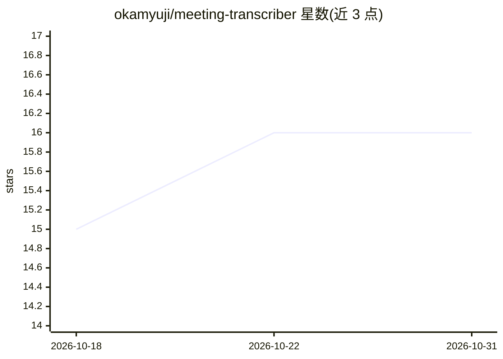

# okamyuji/meeting-transcriber

⭐ 16 · Python · 推送 2026-10-25 · [GitHub](https://github.com/okamyuji/meeting-transcriber) · 个人维护 · 中文 README

**完全本地运行的日语会议转写与议事录自动生成工具**

面向需要隐私保护会议记录的用户：用 faster-whisper 在本地转写日语录音，用 Ollama 上的本地 LLM 自动生成议事录，支持从 Markdown 知识库检索术语的 RAG 修正功能。初次安装后可完全离线运行，音频、转写文本与议事录均保存在本地文件、不外发。提供录音→转写→议事录的完整工作流及针对现有文件、单独录音等菜单模式，CPU 即可运行。限制：仅支持 macOS/Linux，需 Python 3.11+，议事录生成需另行安装 Ollama。

## 筛选速览

| 维度 | 判定 | 备注 |
|---|---|---|
| AI 角色 | `ai-native` | 本体是模型或模型工具 |
| 许可风险 | `none` | — |
| 部署形态 | `None` |  |
| 模型依赖 | local-ok | 支持本地模型 |
| 硬件要求 | — | 无带数字的原话,不猜 |
| 安装摩擦 | `low` | 无编译、无系统依赖或容器化 |
| 成熟度 | — | 结构信号不足 |

## 能力要点

- faster-whisper 本地日语转写（支持 kotoba-whisper CTranslate2 版）
- Ollama 本地 LLM 自动生成议事录（num_ctx 最大可扩至 32768）
- 基于 Markdown 知识库的 RAG 术语修正，嵌入缓存加速二次启动
- 初安装后可完全离线运行，所有数据仅存本地

## 适用场景

- 机密会议或无法上传云端的录音需要本地转写并生成议事录
- 无网络环境下进行会议录音、转写与整理
- 用组织内术语知识库修正转写与议事录用词

## 场景标签

`语音识别` `RAG` `AI 写作` · 领域:内容生成

## 证据(README 行号)

> L3: 完全ローカルで動作する日本語向け会議文字起こしと議事録自動生成ツールです。音声の文字起こしはfaster-whisperが担い、議事録の作成はOllama上のローカルLLMが担うため、データを外部に送らずに会議を記録できます。
> L8: - faster-whisperで日本語音声を文字起こしできます
> L9: - Ollamaの任意のローカルLLMで議事録を自動生成できます

## 星数曲线

2026-10-18 15 → 2026-10-31 16（+1）

---
*卡片 v1 · prompt 1.4 · 生成 2026-10-30 · 置信度 high · 依据 README sha `f74a8fa9fc3a` · [字段定义](../../DATASET.md)*
