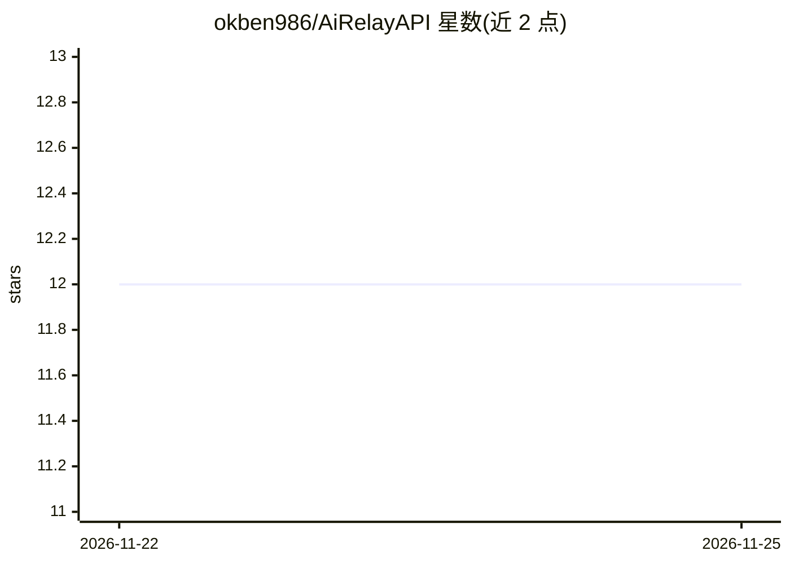

# okben986/AiRelayAPI

⭐ 12 · GPL-3.0 · 推送 2026-11-21 · [GitHub](https://github.com/okben986/AiRelayAPI) · [官网](https://okben986.github.io/AiRelayAPI/) · 个人维护 · 中文 README

**面向国内用户的 AI API 中转站推荐清单**

一份以 README 形式维护的中转站（API 聚合/代理服务）推荐清单，面向在国内使用 Claude、GPT、Gemini 等模型的开发者与用户。内容为 5 个中转站的介绍：各站支持的模型、每百万 Token 计费价格、最低充值金额、优惠码与注册链接，并给出挑选中转站时的稳定性、节点地区、模型覆盖、计费透明度、运营主体等考量维度。作者注明持续更新，无代码、无安装说明。

## 筛选速览

| 维度 | 判定 | 备注 |
|---|---|---|
| AI 角色 | `ai-knowledge` | 知识聚合/清单类 |
| 许可风险 | `viral` | GPL-3.0 |
| 部署形态 | `None` |  |
| 模型依赖 | — | README 未给出锁定关系 |
| 硬件要求 | — | 无带数字的原话,不猜 |
| 安装摩擦 | `low` | 无编译、无系统依赖或容器化 |
| 成熟度 | — | 结构信号不足 |

## 能力要点

- 收录 PackyCode、RightCode、APINEBULA、hao.ai、ToTokens 等 5 个中转站
- 列出各站模型与每百万 Token 进/出价格及更新日期
- 给出选择中转站的 5 项考量维度
- 附优惠码、充值门槛与试用建议

## 适用场景

- 在国内寻找可访问 Claude、GPT、Gemini 等模型的 API 中转渠道
- 比较各中转站的计费价格、稳定性与最低充值门槛
- 为团队或企业选择提供合同、发票与高并发支持的平台

## 场景标签

`精选清单` · 领域:学习与行业

## 证据(README 行号)

> L16: ## 推荐的中转站
> L55: APINEBULA 是银河录像局旗下的企业级 AI 聚合平台，背靠大平台资源，面向开发者、团队与企业用户，提供稳定、高性价比的大模型 API 接入服务。平台聚合 Claude、GPT、Gemini 等主流满血模型——一个接口，即可

## 星数曲线

2026-11-22 12 → 2026-11-25 12（+0）

---
*卡片 v1 · prompt 1.4 · 生成 2026-11-22 · 置信度 high · 依据 README sha `f506dc23175c` · [字段定义](../../DATASET.md)*
